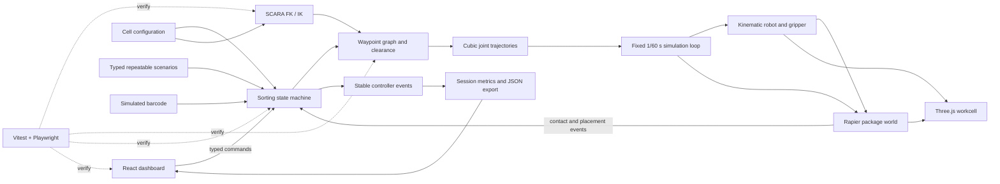

# SortLab Architecture Decision

**Status:** Phases 1–6 implemented locally. Phase 6 adds reproducible headless campaigns over the production controller/Rapier path and records validation evidence. Swept collision validation and physical robot validation remain unimplemented.

**Date:** 2026-10-17

## Selected stack

- TypeScript + React 19 + Vite for application logic, UI, and development server. Phase 1 pins React/React DOM 19.3.0 and Vite 7.3.7.
- React Three Fiber 9 + Three.js/WebGL 2 for the interactive scene. Phase 1 pins R3F 9.4.2 and Three.js 0.185.0.
- Rapier 3D JavaScript deterministic compatibility build for fixed-step package physics, static support/bin colliders, package contact sensors, and a fixed-joint grasp/release model. Phase 3 uses package 0.21.0; robot links remain kinematic visuals.
- Application-owned analytic SCARA FK/IK, joint-limit validation, deterministic cubic joint trajectories, and a fixed-cell Cartesian waypoint planner. The Phase 4 finite-state controller executes sampled routes; swept collision/clearance checks remain future work.
- Vitest 4.1.12 for engineering unit tests and Playwright Core 1.63.0 for the cached Chromium browser smoke test.
- Markdown + Mermaid as source documentation; cumulative report export follows the university format.

Use compatible stable versions pinned in package-lock.json; avoid canary/alpha and unpinned latest. React docs list 19.3.0; R3F v9 pairs with React 19. Vite 8 was first pinned but npm correctly rejected it with plugin-react 5.1.2 (whose peer range ends at Vite 7), so the compatible Vite 7.3.7 release is used. Both documented Vite majors require Node 20.19+ or 22.12+; the observed Node 26.9 satisfies the floor. React/R3F and Vite requirements were checked against official docs on 2026-10-17. [React versions](https://react.dev/versions), [R3F compatibility](https://r3f.docs.pmnd.rs/getting-started/installation), [Vite requirements](https://vite.dev/guide/), [Vite 8 Node support](https://vite.dev/blog/announcing-vite8.html).

### Implemented foundation and Phase 2 status

The app separates `src/engineering` (typed baseline/config validation, FK/IK, trajectories/routes, package physics, autonomous controller, scenario registry, and event metrics), `src/components` (3D workcell and reusable dashboard panels), and `src/App.tsx` (composition and fixed-step adapter). Direct inspection, route playback, and package attachment use the same joint state and FK convention. Rapier loads asynchronously and its package/gripper state is tested separately from React.

The diagram shows the implemented route, controller, fixed-step simulation, package lifecycle and presentation path. Swept collision checking and performance evaluation remain future work. Route execution is simulated and is not collision-safe.

### Rationale and scope

The interface and 3D workcell need shared live state; the browser stack delivers these together on the available Mac without requiring a ROS/native-simulator setup. TypeScript domain logic can be tested independently of rendering. Rapier adds meaningful package contact/fall/release behavior.

This is a kinematic educational digital twin, not an industrial dynamics twin: robot motion follows commanded joints and explicit speed/acceleration limits; link inertia, calibrated motors, compliance and safety-rated controls are not modeled. Rapier is not the robot controller. Its kinematic bodies ignore contact forces, so application collision queries and controller stops are mandatory. [Rapier body types](https://rapier.rs/docs/user_guides/javascript/rigid_body_type/).

Webots remains a contingency only if the course expects a dedicated robotics simulator. Gazebo Harmonic + ROS 2 is not selected because official docs describe macOS as best-effort and its GUI as unstable; the extra ROS/native setup is not justified for this fixed four-axis cell. CoppeliaSim adds another app/integration surface. A hand-scripted Three.js-only animation is a fallback if physics integration fails. General RRT/MoveIt is unnecessary for three fixed stations: use a bounded waypoint graph with complete collision checks. [Gazebo support caveats](https://gazebosim.org/docs/harmonic/install/), [macOS behavior](https://gazebosim.org/docs/harmonic/getstarted/).

## Target architecture and module contracts

Phase 4 implements the controller and placement accounting. Phase 5 implements a typed scenario registry and event recorder. Phase 6's independent validation runner imports the same route, controller, placement classifier, and Rapier implementation; its controlled injections are isolated from normal UI behavior.

| Module             | Owns                                                                                                                    | Interface                                                                  |
| ------------------ | ----------------------------------------------------------------------------------------------------------------------- | -------------------------------------------------------------------------- |
| Domain/config      | Units, geometry, limits, speeds, package/bin definitions, scenarios                                                     | Validated immutable config                                                 |
| Kinematics         | FK/IK, elbow branches, wrist yaw, singularities and limit margins                                                       | Pose ↔ joint solution with explicit failure reason                        |
| Route planner      | **Phase 2:** fixed-cell named TCP waypoints, analytic IK, continuous elbow branch, route failure                        | Typed waypoint route and sampled Cartesian trajectory; no collision margin |
| Trajectory         | **Phase 2:** cubic joint profile with analytic bounds; Cartesian waypoint timing with sampled speed/acceleration checks | Deterministic timestamped joint states and FK poses                        |
| Controller         | **Phase 4:** state transitions, configured package/bin mapping, route validation, bounded grasp retry, cancellation, placement verification and event generation | Typed start/pause/abort/reset operations and snapshot |
| Simulation adapter | **Phase 3/4:** fixed-step Rapier package/environment bodies, sensor-pad grasp gate, fixed-joint carry, dynamic release, package pose and velocity. Robot remains kinematic in React/Three. | Fixed tick steps coordinated with controller commands |
| Presentation       | Scene geometry, camera, UI controls and read-only state display                                                         | Commands to controller; events/metrics from controller                     |
| Evaluation         | **Phase 5:** typed scenarios, deduplicated session metrics and JSON export; **Phase 6:** headless production-path nominal/fault campaigns and numerical/physics measurements | Session UI metrics and machine-readable campaign artifacts |
| Documentation      | Requirement mapping, assumptions, calculations, diagrams, cumulative report history                                     | Evidence traceability                                                      |

## Simulation loop and data flow

1. Manual preview selects an existing fixed-cell route; autonomous start resolves the selected package's configured destination and validates the route and return-home cubic before commanding motion.
2. Package identity is operator-selected; there is no camera or barcode sensor. The controller coordinates pickup, grasp, lift, route transport, release, placement verification and return home.
3. FK/IK checks pose, joint limits, and branches. The Phase 2 route builder tests both elbow branches for the fixed elevated-corridor waypoints and selects the fastest feasible continuous route.
4. Phase 2 verifies joint-space cubic extrema analytically and checks Cartesian route velocity/acceleration on the deterministic 1/60 s sample grid. It does not test links/packages against conveyor or bins; Phase 2 path clearance is not established.
5. Control and physics advance on a fixed 1/60 s tick with capped catch-up. Rendering interpolates state separately at display refresh; frame rate never defines cycle time. Pause/step act on simulation ticks.
6. The Phase 4 controller commands sampled joint states and derives the TCP before each fixed Rapier step. The package follows the robot only while the Phase 3 fixed-joint attachment is active.
7. Start resolves the selected package's configured destination, plans and validates motion before execution, verifies the actual grasp result, and releases dynamically at the route target. Lost attachment faults the cycle.
8. Placement accounting checks package-size-shrunk bin interior bounds and Rapier linear/angular velocity for a 0.25 s settling window. It awards a sort only for the configured destination. This pose-based simulated check is not camera or hardware sensing.

The browser animation loop is not the physics timestep. Phase 3 uses the configured 1/60 s accumulator and caps catch-up to six steps per rendered frame; excess delayed wall time is discarded. A grasp attempt itself advances one Rapier fixed step to refresh contact pairs; Phase 6 instrumentation makes the controller skip its outer physics step on that tick so simulation and controller time remain aligned. When carrying, direct joint controls and route selection/scrubbing are disabled to avoid teleporting the attached body. This is not an industrial servo controller.

## State machine and fault behavior

Idle → Selecting → Planning → MovingToPickup → AligningAndGrasping → Lifting → Transporting → Releasing → VerifyingPlacement → ReturningHome → Completed.

- Unknown ID: hold at pickup, log, await operator reset; never guess destination.
- Missed grasp: one controlled retry; second miss enters a recoverable fault with no success count.
- Full/blocked bin or no valid route: stop before entry and wait/report.
- Collision guard, trajectory timeout or simulated emergency stop: stop commanded motion, latch a fault; checked home/reset is operator initiated.
- Wrong-bin/outside-bin placement, timeout, release failure or lost attachment: no sort credit; latch a typed fault with package, destination, simulation time and explanation.
- Reset must preserve one clear owner for each package so it cannot duplicate or vanish.

## Planning, UI and metrics

The Phase 2 planner is fixed-cell rather than general warehouse navigation. It checks sampled TCP IK continuity, joint limits, and configured speed/acceleration constraints for an elevated corridor. It does not check link/package envelopes, bin entry collision, or swept volume. Alternate elbow branches are tried. Future collision checks must be completed before treating a route as safe to execute.

Current UI: 3D cell and route overlay; route selection/playback; direct joint inspection; package category/reset; open/close/grasp/release; and an autonomous panel. The Phase 5 dashboard shows live joint/controller/simulation status, nominal S/M/L and controlled route/grasp/placement fault scenarios, event history, success/failure breakdowns, cycle-time average, retry and rejection counts, and downloadable session JSON. Manual controls lock during an autonomous cycle. Scenario hooks test controller outcomes without changing ordinary Rapier behavior. Autonomous barcode sensing is not implemented.

Metric definitions: terminal attempts equal completed + faulted + aborted cycles; success rate is completed / terminal attempts; average cycle time includes completed attempts only; placement success requires the controller's accepted target-bin placement event. Category/bin outcomes count terminal attempts only. Grasp success/retry and placement/route rejection counts come from deduplicated controller result/fault events. Zero-attempt rates and zero-completed averages display as unavailable. Phase 5 does not calculate packages/minute, path clearance, or campaign distributions.

## Verification

- Vitest: FK/IK, workspace, cubic trajectories/routes, Rapier initialization/fixed steps/reset, all package proxies, contact-gated grasp, carry/release, full S/M/L autonomous Rapier cycles, controller transitions/recovery, placement acceptance/rejection and reset lifecycle. Swept collision clearance remains untested and unimplemented.
- Playwright: load, WebGL render, manual controls/routes/grasp/release, autonomous completion, nominal S and unreachable-route scenarios, and JSON metric export.
- Engineering review: independently recompute representative kinematics and grip force; review clearance and diagrams.
- Phase 6: 100 nominal cycles, 36 injected fault trials, 5,000 deterministic FK/IK samples, 6,561 workspace points, route/trajectory checks, and repeated fixed-step physics measurements. Raw and summary outputs are in `validation/results/`; analysis and commands are in `docs/PHASE-6-VALIDATION.md`.

The deterministic Rapier JS/WASM variant is selected to improve repeatability. Rapier documents cross-platform deterministic execution but requires identical initialization/order/steps; initialization math such as sin/cos may vary. We therefore require fixed-step, seeded scenarios and claim only repeatability demonstrated for the recorded app/runtime. The compat build embeds WASM, increasing bundle size for simpler bundler support; cell scale is small. [Rapier determinism](https://rapier.rs/docs/user_guides/javascript/determinism/), [package variants](https://www.npmjs.com/package/%40dimforge/rapier3d-deterministic-compat).

## Limits and licenses

No real camera, barcode hardware, calibrated motor torque/current, link flexibility, gear backlash, contact compliance, industrial safety, stopping distance, physical throughput, endurance or hardware result is claimed. "Digital twin" means a software model of the proposed cell, not a live-connected physical installation.

Current package listings/docs identify R3F as MIT and Rapier JS as Apache-2.0. Retain third-party notices and verify selected dependency licenses before release. [R3F license](https://github.com/pmndrs/react-three-fiber/blob/master/LICENSE), [Rapier package](https://www.npmjs.com/package/%40dimforge/rapier3d-deterministic-compat).
