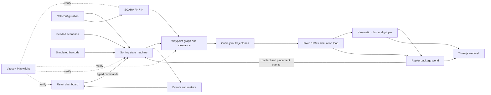

# SortLab Architecture Decision

**Status:** Phase 1 foundation, Phase 2 trajectory/route preview, and Phase 3 package physics/gripper transfer implemented locally. Autonomous sorting remains planned.

**Date:** 2026-10-17

## Selected stack

- TypeScript + React 19 + Vite for application logic, UI, and development server. Phase 1 pins React/React DOM 19.3.0 and Vite 7.3.7.
- React Three Fiber 9 + Three.js/WebGL 2 for the interactive scene. Phase 1 pins R3F 9.4.2 and Three.js 0.185.0.
- Rapier 3D JavaScript deterministic compatibility build for fixed-step package physics, static support/bin colliders, package contact sensors, and a fixed-joint grasp/release model. Phase 3 uses package 0.21.0; robot links remain kinematic visuals.
- Application-owned analytic SCARA FK/IK, joint-limit validation, deterministic cubic joint trajectories, and a fixed-cell Cartesian waypoint planner. Swept collision/clearance checks and finite-state sorting control remain future work.
- Vitest 4.1.12 for engineering unit tests and Playwright Core 1.63.0 for the cached Chromium browser smoke test.
- Markdown + Mermaid as source documentation; cumulative report export follows the university format.

Use compatible stable versions pinned in package-lock.json; avoid canary/alpha and unpinned latest. React docs list 19.3.0; R3F v9 pairs with React 19. Vite 8 was first pinned but npm correctly rejected it with plugin-react 5.1.2 (whose peer range ends at Vite 7), so the compatible Vite 7.3.7 release is used. Both documented Vite majors require Node 20.19+ or 22.12+; the observed Node 26.9 satisfies the floor. React/R3F and Vite requirements were checked against official docs on 2026-10-17. [React versions](https://react.dev/versions), [R3F compatibility](https://r3f.docs.pmnd.rs/getting-started/installation), [Vite requirements](https://vite.dev/guide/), [Vite 8 Node support](https://vite.dev/blog/announcing-vite8.html).

### Implemented foundation and Phase 2 status

The app separates `src/engineering` (typed baseline/config validation, FK/IK, trajectories/routes, and `packagePhysics.ts`), `src/components` (3D workcell and status/route/package panels), and `src/App.tsx` (composition and fixed-step adapter). Direct inspection, route playback, and package attachment use the same joint state and FK convention. Rapier loads asynchronously and its package/gripper state is tested separately from React.

The diagram shows the implemented path from UI through fixed-cell route planning, IK, sampled trajectories, and the rendered arm. Controller, simulation physics, package lifecycle, collision checking, and performance evaluation links remain future contracts. Phase 2 does not implement a collision planner, package physics, sorting flow, or full operations dashboard.

### Rationale and scope

The interface and 3D workcell need shared live state; the browser stack delivers these together on the available Mac without requiring a ROS/native-simulator setup. TypeScript domain logic can be tested independently of rendering. Rapier adds meaningful package contact/fall/release behavior.

This is a kinematic educational digital twin, not an industrial dynamics twin: robot motion follows commanded joints and explicit speed/acceleration limits; link inertia, calibrated motors, compliance and safety-rated controls are not modeled. Rapier is not the robot controller. Its kinematic bodies ignore contact forces, so application collision queries and controller stops are mandatory. [Rapier body types](https://rapier.rs/docs/user_guides/javascript/rigid_body_type/).

Webots remains a contingency only if the course expects a dedicated robotics simulator. Gazebo Harmonic + ROS 2 is not selected because official docs describe macOS as best-effort and its GUI as unstable; the extra ROS/native setup is not justified for this fixed four-axis cell. CoppeliaSim adds another app/integration surface. A hand-scripted Three.js-only animation is a fallback if physics integration fails. General RRT/MoveIt is unnecessary for three fixed stations: use a bounded waypoint graph with complete collision checks. [Gazebo support caveats](https://gazebosim.org/docs/harmonic/install/), [macOS behavior](https://gazebosim.org/docs/harmonic/getstarted/).

## Target architecture and module contracts

The controller, scenarios, collision guard, placement accounting, and evaluation links below are future architecture; Phase 3 does not implement them.

| Module             | Owns                                                                                                                    | Interface                                                                  |
| ------------------ | ----------------------------------------------------------------------------------------------------------------------- | -------------------------------------------------------------------------- |
| Domain/config      | Units, geometry, limits, speeds, package/bin definitions, scenarios                                                     | Validated immutable config                                                 |
| Kinematics         | FK/IK, elbow branches, wrist yaw, singularities and limit margins                                                       | Pose ↔ joint solution with explicit failure reason                        |
| Route planner      | **Phase 2:** fixed-cell named TCP waypoints, analytic IK, continuous elbow branch, route failure                        | Typed waypoint route and sampled Cartesian trajectory; no collision margin |
| Trajectory         | **Phase 2:** cubic joint profile with analytic bounds; Cartesian waypoint timing with sampled speed/acceleration checks | Deterministic timestamped joint states and FK poses                        |
| Controller         | State transitions, ID routing, retries, timeouts, fault latch, event generation                                         | Typed commands/events                                                      |
| Simulation adapter | **Phase 3:** fixed-step Rapier package/environment bodies, sensor-pad grasp gate, fixed-joint carry, dynamic release. Robot remains kinematic in React/Three. | Package pose/status to UI; controller contract remains future |
| Presentation       | Scene geometry, camera, UI controls and read-only state display                                                         | Commands to controller; events/metrics from controller                     |
| Evaluation         | Seeded scenario sets, run definitions, aggregation and export of raw simulated results                                  | Versioned JSON/CSV run data                                                |
| Documentation      | Requirement mapping, assumptions, calculations, diagrams, cumulative report history                                     | Evidence traceability                                                      |

## Simulation loop and data flow

1. For the current Phase 2 preview, a destination selection chooses a validated fixed-cell route. A future typed start command will select a versioned configuration and seeded scenario.
2. The controller consumes a simulated barcode ID (not camera vision), resolves its bin, requests approach/grasp/lift/transfer/place/retreat/home targets.
3. FK/IK checks pose, joint limits, and branches. The Phase 2 route builder tests both elbow branches for the fixed elevated-corridor waypoints and selects the fastest feasible continuous route.
4. Phase 2 verifies joint-space cubic extrema analytically and checks Cartesian route velocity/acceleration on the deterministic 1/60 s sample grid. It does not test links/packages against conveyor or bins; Phase 2 path clearance is not established.
5. Control and physics advance on a fixed 1/60 s tick with capped catch-up. Rendering interpolates state separately at display refresh; frame rate never defines cycle time. Pause/step act on simulation ticks.
6. **Phase 3:** React/Three updates the kinematic robot from joint state and Rapier advances package bodies at fixed ticks. Package sensor-pad intersections gate the manual grasp and a fixed joint carries the package. There is no robot collision guard, collision-triggered stop, controller event, or automatic placement confirmation yet.
7. A future controller should call the tested Phase 3 gripper operations only after its route and fault policies are defined. Phase 3 itself has no automatic retry or transfer state machine.
8. Future placement accounting should require the package to settle inside the assigned bin; Phase 3 does not award sorting credit or calculate cycle metrics.

The browser animation loop is not the physics timestep. Phase 3 uses the configured 1/60 s accumulator and caps catch-up to six steps per rendered frame; excess delayed wall time is discarded. When carrying, direct joint controls and route selection/scrubbing are disabled to avoid teleporting the attached body. This is not an industrial servo controller.

## State machine and fault behavior

Idle → Validate → Identify → PlanApproach → Approach → Grip → VerifyGrip → Lift → PlanTransfer → Transfer → Place → Release → VerifyPlacement → ReturnHome → Complete.

- Unknown ID: hold at pickup, log, await operator reset; never guess destination.
- Missed grasp: one controlled retry; second miss enters failed/recovery with no success count.
- Full/blocked bin or no valid route: stop before entry and wait/report.
- Collision guard, trajectory timeout or simulated emergency stop: stop commanded motion, latch a fault; checked home/reset is operator initiated.
- Failed placement check: no sort credit; pause for recovery.
- Reset must preserve one clear owner for each package so it cannot duplicate or vanish.

## Planning, UI and metrics

The Phase 2 planner is fixed-cell rather than general warehouse navigation. It checks sampled TCP IK continuity, joint limits, and configured speed/acceleration constraints for an elevated corridor. It does not check link/package envelopes, bin entry collision, or swept volume. Alternate elbow branches are tried. Future collision checks must be completed before treating a route as safe to execute.

Current Phase 3 UI: 3D cell and route overlay; route selection/playback; direct joint inspection; package category/reset; open/close/grasp/release; package pose/state; and control lockout while carrying. Autonomous ID routing, scenario/fault controls, event history, sort counts, and performance dashboard remain planned.

Metrics: correct-sort fraction, wrong-bin count, retry rate, faults/recoveries, cycle-time distribution, packages per simulated minute, unreachable-route count, and minimum path clearance. Each metric records denominator, run length, config version, seed, timestep, software lockfile and runtime.

## Verification

- Vitest: FK/IK, workspace, cubic trajectories/routes, Rapier initialization/fixed steps/reset, all package proxies, contact-gated grasp, rejected alignment, carry coordination, release/fall, and repeated lifecycle cleanup. Swept collision clearance and autonomous controller behavior remain future tests.
- Scenario tests: all three nominal package types plus each injected fault; expected terminal state and exact item counts.
- Playwright: load, start/pause/step/reset, scenario/fault controls, visible transfer, UI/event/count agreement.
- Engineering review: independently recompute representative kinematics and grip force; review clearance and diagrams.
- Evaluation: at least 100 nominal cycles plus repeated fault cases. All outputs labeled simulated.

The deterministic Rapier JS/WASM variant is selected to improve repeatability. Rapier documents cross-platform deterministic execution but requires identical initialization/order/steps; initialization math such as sin/cos may vary. We therefore require fixed-step, seeded scenarios and claim only repeatability demonstrated for the recorded app/runtime. The compat build embeds WASM, increasing bundle size for simpler bundler support; cell scale is small. [Rapier determinism](https://rapier.rs/docs/user_guides/javascript/determinism/), [package variants](https://www.npmjs.com/package/%40dimforge/rapier3d-deterministic-compat).

## Limits and licenses

No real camera, barcode hardware, calibrated motor torque/current, link flexibility, gear backlash, contact compliance, industrial safety, stopping distance, physical throughput, endurance or hardware result is claimed. "Digital twin" means a software model of the proposed cell, not a live-connected physical installation.

Current package listings/docs identify R3F as MIT and Rapier JS as Apache-2.0. Retain third-party notices and verify selected dependency licenses before release. [R3F license](https://github.com/pmndrs/react-three-fiber/blob/master/LICENSE), [Rapier package](https://www.npmjs.com/package/%40dimforge/rapier3d-deterministic-compat).
