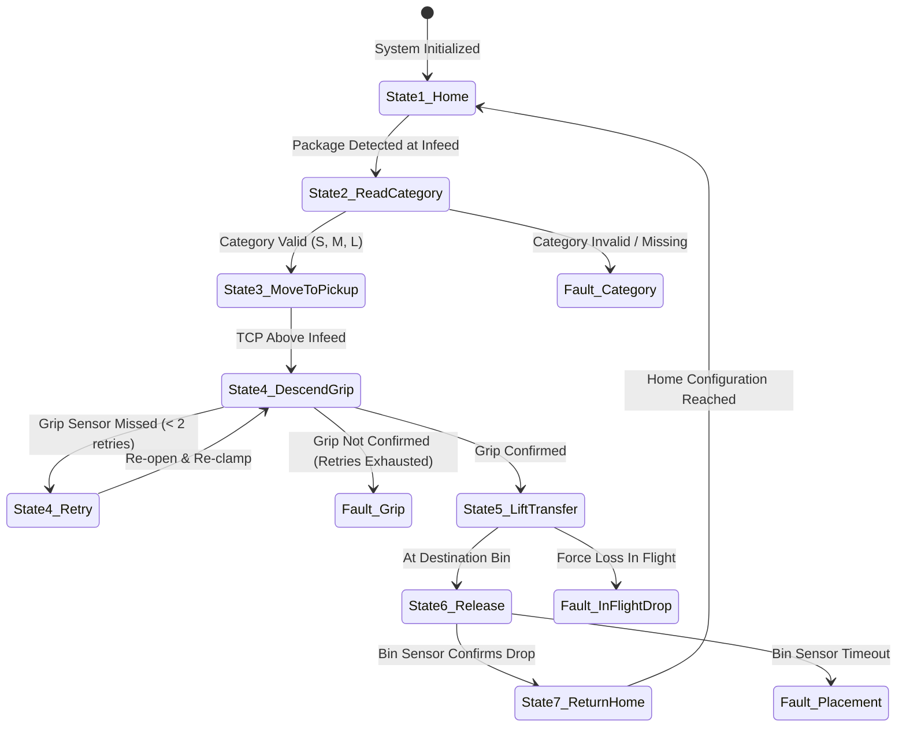

# JAIN UNIVERSITY
### Department of Computer Applications · BCA UG · Semester VII
### ROBOTICS — INDIVIDUAL DESIGN PROJECT

---

# Automated Warehouse Package Sorting Robot
## Week 2 — Engineering Design Review (Version 2.0)

| Metadata Field | Details |
|---|---|
| **Student Name** | Lochan S |
| **Registration / Roll No.** | 23BCAR0263 |
| **Instructor / Supervisor** | Mohit Mistry |
| **Course** | Robotics, BCA UG, Semester VII |
| **Project Option** | Option 01 — Automated Warehouse Package Sorting Robot |
| **Report Milestone** | Week 2 — Engineering Design Review (Standalone) |
| **Milestone Window** | Friday–Sunday, 23–25 October 2026 |
| **Milestone Weight** | 7 marks (of 25 total) |
| **Week 2 Rubric** | Anatomy and kinematics (3); drives and end effector (2); control logic (2) |

> **Design & Simulation Evidence Notice:** This document is an engineering design review workbook. All kinematic equations, coordinate assignments, drive sizing, grip-force mechanics, and supervisory logic are validated through software modeling and analytical calculation. No physical robot build, industrial hardware test, or formal safety certification is claimed.

---

## Contents

1. [Executive Summary & Cell Baseline](#1-executive-summary--cell-baseline)
2. [Refined System Architecture](#2-refined-system-architecture)
3. [Robot Anatomy, Coordinate Frames, and Kinematics](#3-robot-anatomy-coordinate-frames-and-kinematics)
   - 3.1 Structural Anatomy and Joint Inventory
   - 3.2 Coordinate Frame Assignment
   - 3.3 Planar Forward Kinematics (FK) Model
   - 3.4 Step-by-Step Worked FK Example
   - 3.5 Analytical Inverse Kinematics (IK)
   - 3.6 Workspace Reach and Layout Verification
4. [Drive Mechanisms, End Effector, and Force Sizing](#4-drive-mechanisms-end-effector-and-force-sizing)
   - 4.1 Drive Technology Trade-off and Selection
   - 4.2 End Effector Selection and Compatibility
   - 4.3 Transparent Grip-Force Balance and Physics Sizing
   - 4.4 Gripper Capacity vs. Simulation Preset vs. Physics Requirements
   - 4.5 Vertical Axis Ball Screw and Motor Torque Sizing
5. [Control Logic, State Machine, and Safety Systems](#5-control-logic-state-machine-and-safety-systems)
   - 5.1 Supervisory Sorting Control and State Transitions
   - 5.2 Deterministic Failure Response Protocols
   - 5.3 Workcell Hazard Assessment and Safety Architecture
   - 5.4 Practical / Social Impact and Engineering Limitations
6. [References and Change Log](#6-references-and-change-log)
   - 6.1 References
   - 6.2 Dated Cumulative Change Log (V1.0 → V2.0)

---

## 1. Executive Summary & Cell Baseline

Building upon the conceptual layout approved in Week 1, this report presents the engineering design review of a fixed tabletop four-axis SCARA manipulator ($R-R-P-R$) designed to sort incoming warehouse parcels into three dedicated bins. Arriving parcels are identified at a single infeed pick location and transferred based on their size and geometry.

**Table 1. Configured Package Inputs and Destination Mapping**

| Category | Representative Object | Dimensions ($L \times W \times H$) | Mass ($m$) | Destination Bin | Nominal Preset Force | Station Coordinates (Frame $W$) |
|:---:|---|:---:|:---:|:---:|:---:|---|
| **S** | Small carton | $0.08 \times 0.06 \times 0.04\text{ m}$ | $0.10\text{ kg}$ | **Bin A** | $10\text{ N}$ | $(-0.240,\, +0.250,\, 0.250)\text{ m}$ |
| **M** | Medium cylinder | $0.12 \times 0.09 \times 0.06\text{ m}$ | $0.30\text{ kg}$ | **Bin B** | $15\text{ N}$ | $(-0.240,\, 0.000,\, 0.250)\text{ m}$ |
| **L** | Large pouch | $0.16 \times 0.12 \times 0.08\text{ m}$ | $0.60\text{ kg}$ | **Bin C** | $20\text{ N}$ | $(-0.240,\, -0.250,\, 0.250)\text{ m}$ |
| **—** | Pickup Station ($P$) | Infeed presentation center | — | — | — | $(+0.300,\, 0.000,\, 0.250)\text{ m}$ |

*Key Baseline Notes:*
- World coordinate origin is fixed at the shoulder rotation center on the table plane ($z = 0.250\text{ m}$).
- Home position: $\mathbf{q}_{home} = (0.0^\circ,\, 0.0^\circ,\, 0.560\text{ m},\, 0.0^\circ)$ corresponding to TCP at $(+0.550,\, 0.000,\, 0.560)\text{ m}$.
- Target median cycle time: $\le 12.0\text{ s}$ per pick-and-place transfer.

---

## 2. Refined System Architecture

The functional system architecture partitions the sorting cell into software/simulation functions and proposed physical hardware.

*Figure 1. Refined system architecture illustrating signal data flows, actuator drive commands, sensor feedback loops, and supervisory safety interlocks.*

### Functional Subsystem Boundaries
1. **Package Category Input (Software / Simulation):** Receives the package classification ($S$, $M$, or $L$). In the current simulation testbed, this is operator-selected; in a physical cell, an automated barcode/RFID scanner or industrial 2D camera would supply this signal.
2. **Controller and State Machine (Software / Simulation):** Manages cycle sequencing, evaluates analytical forward/inverse kinematics, synthesizes smooth trajectories, monitors grip status, and enforces deterministic error-recovery routines.
3. **SCARA Robot Cell (Proposed Hardware):** Four commanded axes ($J_1$ base rotation, $J_2$ elbow rotation, $J_3$ vertical quill, $J_4$ tool yaw / wrist rotation) fitted with an electric parallel-jaw gripper.
4. **Sensors and Safety System (Proposed Hardware):** Category 3 interlocked perimeter guard, dual-channel E-stop, motor encoder feedback, and optical bin drop verification.
5. **Power Supply (Proposed Hardware):** Industrial AC-to-DC regulated power supply ($24\text{V}$ logic, $48\text{V}$ drive bus).

---

## 3. Robot Anatomy, Coordinate Frames, and Kinematics

### 3.1 Structural Anatomy and Joint Inventory

The selected four-axis SCARA manipulator provides three Cartesian positioning degrees of freedom ($X, Y, Z$) plus tool yaw rotation ($\psi$) about the vertical axis.

*Figure 2. Mechanical anatomy, axis motion conventions, vertical stroke envelope ($0.30 - 0.58\text{ m}$), and configured design parameters.*

**Table 2. Joint Motion Inventory and Physical Boundaries**

| Joint | Motion Type | Variable | Motion Limits | Actuation / Transmission | Engineering Function |
|:---:|:---:|:---:|:---:|---|---|
| **$J_1$** | Revolute | $q_1$ ($\theta_1$) | $-150^\circ \le q_1 \le +150^\circ$ | AC Servo + Harmonic Reducer ($50:1$) | Base / shoulder rotation; sweeps Link 1 ($L_1 = 0.30\text{ m}$) across table. |
| **$J_2$** | Revolute | $q_2$ ($\theta_2$) | $-160^\circ \le q_2 \le +160^\circ$ | AC Servo + Harmonic Reducer ($30:1$) | Elbow rotation; positions Link 2 ($L_2 = 0.25\text{ m}$) to set planar radial reach. |
| **$J_3$** | Prismatic | $q_3$ ($z$) | $0.300\text{ m} \le q_3 \le 0.580\text{ m}$ | BLDC Servo + Ball Screw ($5\text{ mm}$ pitch) | Vertical quill translation; governs approach, pick lift, and bin placement. |
| **$J_4$** | Revolute | $q_4$ ($\theta_4$) | $-180^\circ \le q_4 \le +180^\circ$ | Compact BLDC Servo + Miniature Gearhead | Wrist rotation / Tool yaw; rotates parallel gripper jaws about vertical $Z$-axis. |

*Terminology Note on $J_4$:* In system diagrams, $J_4$ is alternately referenced as **"Tool yaw"** (Figure 1) and **"Wrist rotation"** (Figure 2). These terms are engineering synonyms denoting rotation of the end effector about the vertical tool quill axis.

---

### 3.2 Coordinate Frame Assignment

Coordinate frames adhere to right-handed Cartesian conventions:
- **World Frame $\{W\} = \{X_0, Y_0, Z_0\}$:** Origin located at the intersection of the $J_1$ rotation axis and the table surface ($z = 0.250\text{ m}$). $+X_0$ extends forward toward pickup station $P$; $+Y_0$ points toward Bin A; $+Z_0$ points vertically upward.
- **Link 1 Frame $\{1\} = \{X_1, Y_1, Z_1\}$:** Attached to Link 1 with origin at Joint 1, $+X_1$ aligned along Link 1 toward Joint 2.
- **Link 2 Frame $\{2\} = \{X_2, Y_2, Z_2\}$:** Attached to Link 2 with origin at Joint 2, $+X_2$ aligned along Link 2 toward the vertical quill axis.
- **Tool Frame $\{3\} = \{X_3, Y_3, Z_3\}$:** Origin at the Tool Center Point (TCP) centered between the parallel jaw faces.

*Figure 3. Coordinate frame definitions, link vector geometry, and kinematic angle conventions.*

---

### 3.3 Planar Forward Kinematics (FK) Model

Because axes $J_1$, $J_2$, and $J_4$ are parallel vertical axes and $J_3$ is purely vertical, the kinematics decouple cleanly into horizontal planar trigonometry and vertical translation:

$$\begin{aligned}
x &= L_1 \cos(q_1) + L_2 \cos(q_1 + q_2) \\
y &= L_1 \sin(q_1) + L_2 \sin(q_1 + q_2) \\
z &= q_3 \\
\psi &= q_1 + q_2 + q_4
\end{aligned}$$

Where:
- $L_1 = 0.300\text{ m}$, $L_2 = 0.250\text{ m}$.
- $q_1, q_2$ are joint angles in radians (or degrees).
- $q_3$ represents the absolute world-$Z$ elevation of the TCP in metres.
- $\psi$ is the net tool yaw angle relative to world $+X_0$.

---

### 3.4 Step-by-Step Worked FK Example

To provide complete numerical verification as required by the Week 2 rubric, the forward kinematics equations are evaluated for an intermediate transition configuration:

**Given Joint Input Vector:**
$$\mathbf{q} = \begin{bmatrix} q_1 \\ q_2 \\ q_3 \\ q_4 \end{bmatrix} = \begin{bmatrix} 0.0^\circ \\ -20.0^\circ \\ 0.450\text{ m} \\ 0.0^\circ \end{bmatrix} = \begin{bmatrix} 0.000000\text{ rad} \\ -0.349066\text{ rad} \\ 0.450000\text{ m} \\ 0.000000\text{ rad} \end{bmatrix}$$

**Step 1: Compute absolute link angles:**
$$\theta_1 = q_1 = 0.0^\circ$$
$$\theta_2 = q_1 + q_2 = 0.0^\circ + (-20.0^\circ) = -20.0^\circ$$

**Step 2: Evaluate trigonometric functions:**
$$\cos(\theta_1) = \cos(0.0^\circ) = 1.000000, \quad \sin(\theta_1) = \sin(0.0^\circ) = 0.000000$$
$$\cos(\theta_2) = \cos(-20.0^\circ) = +0.939693, \quad \sin(\theta_2) = \sin(-20.0^\circ) = -0.342020$$

**Step 3: Calculate horizontal Cartesian position ($x, y$):**
$$\begin{aligned}
x &= L_1 \cos(\theta_1) + L_2 \cos(\theta_2) \\
  &= (0.300\text{ m} \times 1.000000) + (0.250\text{ m} \times 0.939693) \\
  &= 0.300000\text{ m} + 0.234923\text{ m} \\
  &= \mathbf{0.534923\text{ m}} \approx \mathbf{0.535\text{ m}}
\end{aligned}$$

$$\begin{aligned}
y &= L_1 \sin(\theta_1) + L_2 \sin(\theta_2) \\
  &= (0.300\text{ m} \times 0.000000) + (0.250\text{ m} \times (-0.342020)) \\
  &= 0.000000\text{ m} - 0.085505\text{ m} \\
  &= \mathbf{-0.085505\text{ m}} \approx \mathbf{-0.086\text{ m}}
\end{aligned}$$

**Step 4: Determine elevation and tool yaw orientation:**
$$z = q_3 = \mathbf{0.450000\text{ m}}$$
$$\psi = q_1 + q_2 + q_4 = 0.0^\circ + (-20.0^\circ) + 0.0^\circ = \mathbf{-20.0^\circ} \quad (-0.349066\text{ rad})$$

**Resulting TCP Pose in Frame $\{W\}$:**
$$\mathbf{p}_{TCP} = \begin{bmatrix} x \\ y \\ z \\ \psi \end{bmatrix} = \begin{bmatrix} 0.535\text{ m} \\ -0.086\text{ m} \\ 0.450\text{ m} \\ -20.0^\circ \end{bmatrix}$$

This confirms analytical agreement with the software simulation coordinate transform.

---

### 3.5 Analytical Inverse Kinematics (IK)

Given a target position and orientation $(x, y, z, \psi)$, the controller computes joint angles algebraically:
1. **Target Radius:** $r^2 = x^2 + y^2$.
2. **Elbow Joint Angle ($q_2$):**
   $$\cos(q_2) = \frac{x^2 + y^2 - L_1^2 - L_2^2}{2 L_1 L_2}$$
   Selecting the collision-free elbow-down posture:
   $$\sin(q_2) = -\sqrt{1 - \cos^2(q_2)}$$
   $$q_2 = \text{atan2}\left(\sin(q_2),\, \cos(q_2)\right)$$
3. **Shoulder Joint Angle ($q_1$):**
   $$q_1 = \text{atan2}(y, x) - \text{atan2}\left(L_2 \sin(q_2),\, L_1 + L_2 \cos(q_2)\right)$$
4. **Vertical Axis ($q_3$) and Tool Yaw ($q_4$):**
   $$q_3 = z, \qquad q_4 = \psi - (q_1 + q_2)$$

---

### 3.6 Workspace Reach and Layout Verification

*Figure 4. Configured stations, top-view reach boundaries, side-view vertical travel, and workspace parameters.*

#### Reach Envelope Analysis and Resolution of Boundary Conditions
A critical engineering distinction must be made between theoretical kinematic reach and physical joint-limited reach:
1. **Ideal Kinematic Boundaries:**
   - Outer boundary: $R_{max} = L_1 + L_2 = 0.300 + 0.250 = \mathbf{0.550\text{ m}}$.
   - Theoretical inner limit (at $q_2 = \pm 180^\circ$): $R_{min,ideal} = |L_1 - L_2| = |0.300 - 0.250| = \mathbf{0.050\text{ m}}$.
2. **Effective Physical Boundary with Joint Limits ($|q_2| \le 160^\circ$):**
   Because Joint 2 is mechanically and in software bounded to $\pm 160^\circ$ to prevent forearm collisions with the shoulder housing, the links cannot fully fold to $180^\circ$. By the Law of Cosines, the *effective inner boundary* is:
   $$R_{min,effective} = \sqrt{L_1^2 + L_2^2 + 2 L_1 L_2 \cos(160^\circ)} = \sqrt{0.30^2 + 0.25^2 + 2(0.30)(0.25)(-0.93969)} \approx \mathbf{0.1075\text{ m}} \approx \mathbf{0.108\text{ m}}$$
   *Governing Value:* While Figure 4 illustrates the $0.05\text{ m}$ circle as the theoretical minimum, the **effective minimum operational reach is $0.108\text{ m}$**.

3. **Verification of Station Coordinates:**
   - Pickup Position $P (+0.300, 0.000)\text{ m}$: Radial distance $r_P = 0.300\text{ m}$.
   - Bin A $(-0.240, +0.250)\text{ m}$: Radial distance $r_A = \sqrt{(-0.24)^2 + 0.25^2} = 0.3466\text{ m} \approx 0.347\text{ m}$.
   - Bin B $(-0.240, 0.000)\text{ m}$: Radial distance $r_B = 0.240\text{ m}$.
   - Bin C $(-0.240, -0.250)\text{ m}$: Radial distance $r_C = \sqrt{(-0.24)^2 + (-0.25)^2} = 0.3466\text{ m} \approx 0.347\text{ m}$.
   - Clearance Transit Corridor $(+0.120, \pm 0.400)\text{ m}$: Radial distance $r_{trans} \approx 0.418\text{ m}$.

*Conclusion:* All four stations and transit corridors satisfy $0.108\text{ m} < \{0.240\text{ m}, 0.300\text{ m}, 0.347\text{ m}, 0.418\text{ m}\} < 0.550\text{ m}$. All targets reside safely inside the reachable annular band.

*Drawing Scale Clarification:* Figures 3(a), 4(a), 4(c), and 7(b) present **schematic functional layouts** designed to show topological relationships, station mappings, and reach circles clearly. The numerical coordinates tabulated in Table 1 and Table 2 represent the precise mathematical truth used by the inverse kinematics solver.

---

## 4. Drive Mechanisms, End Effector, and Force Sizing

### 4.1 Drive Technology Trade-off and Selection

**Table 3. Drive Technology Comparison Matrix**

| Technology | Advantages | Trade-offs / Limitations | Selection Verdict |
|---|---|---|---|
| **Pneumatic Cylinders** | Inexpensive, high velocity, simple construction. | No intermediate position control; spongy dynamics; requires $6\text{ bar}$ air compressor. | **Rejected** |
| **Hydraulic Drives** | Enormous force density, stiff load holding. | High cost; severe fluid leakage risks; bulky pump unit disproportionate for $< 1\text{ kg}$ parcels. | **Rejected** |
| **All-Electric Servos** | Precise multi-axis trajectory synchronization; programmable acceleration; clean; standard DC bus. | Requires precision gear reducers (harmonic drives) to deliver required joint torque. | **SELECTED:** Brushless AC/DC servomotors with harmonic gearing and ball screws. |

---

### 4.2 End Effector Selection and Compatibility

**Table 4. End Effector Technology Trade-off**

| Gripper Type | Small Carton (S) | Cylinder (M) | Pouch (L) | Verdict & Justification |
|---|---|---|---|---|
| **Vacuum Suction Cup** | Excellent (flat surface) | Poor (curved perimeter breaks vacuum seal) | Poor (wrinkled pouch film causes leaks; contents sag) | **Rejected:** Cannot reliably grasp mixed packaging shapes. |
| **Magnetic Gripper** | Ineffective | Ineffective | Ineffective | **Rejected:** Packages are non-ferrous paper, plastic, and pouch materials. |
| **2-Finger Parallel Jaw** | Excellent (opposed planar clamping) | Good (line contact across diameter) | Good (perimeter clamping with wide compliant pads) | **SELECTED:** Electric parallel-jaw gripper ($30 - 160\text{ mm}$ stroke) with high-friction nitrile rubber pads. |

---

### 4.3 Transparent Grip-Force Balance and Physics Sizing

*Figure 5. Conceptual joint drive configuration, electric parallel gripper anatomy, parameter table, and gripping force screening logic.*

#### Physics Balance Equations
For a symmetric two-finger parallel jaw holding a package of mass $m$ during vertical lift:
- Clamping normal force per jaw: $N$.
- Friction coefficient between jaw pad rubber and packaging surface: $\mu$.
- Total available upward frictional holding force: $F_{fric} = 2 \times \mu \times N$.
- Dynamic vertical load during lift (acceleration $a_z = 0.30\text{ m/s}^2$, gravity $g = 9.81\text{ m/s}^2$):
  $$F_{dyn} = m (g + a_z)$$
- Incorporating an engineering safety factor $S = 2.0$:
  $$F_{fric} \ge S \times F_{dyn} \implies 2 \mu N \ge S m (g + a_z)$$
- Minimum required normal clamping force per jaw:
  $$N_{required} = \frac{S \cdot m \cdot (g + a_z)}{2 \mu}$$

#### Sizing for Heaviest Load (Category L Pouch, $m = 0.60\text{ kg}$)
- Effective vertical acceleration: $g + a_z = 9.81 + 0.30 = 10.11\text{ m/s}^2$.
- Dynamic vertical load: $F_{dyn} = 0.60\text{ kg} \times 10.11\text{ m/s}^2 = 6.066\text{ N}$.
- Required frictional resistance with safety factor $S = 2.0$: $F_{hold} = 2.0 \times 6.066\text{ N} = 12.132\text{ N}$.

**Condition 1: Nominal Matte Packaging ($\mu = 0.50$):**
$$N_{req,\mu=0.50} = \frac{12.132\text{ N}}{2 \times 0.50} = \frac{12.132\text{ N}}{1.00} = \mathbf{12.132\text{ N per jaw}} \approx \mathbf{12.13\text{ N/jaw}}$$
Total clamping normal force across both jaws: $N_{total} = 2 \times 12.13 = \mathbf{24.26\text{ N}}$.

**Condition 2: Low-Friction Glossy Packaging ($\mu = 0.30$):**
$$N_{req,\mu=0.30} = \frac{12.132\text{ N}}{2 \times 0.30} = \frac{12.132\text{ N}}{0.60} = \mathbf{20.220\text{ N per jaw}} \approx \mathbf{20.22\text{ N/jaw}}$$
Total clamping normal force across both jaws: $N_{total} = 2 \times 20.22 = \mathbf{40.44\text{ N}}$.

---

### 4.4 Gripper Capacity vs. Simulation Preset vs. Physics Requirements

To ensure complete clarity regarding the force numbers presented across this workbook:
1. **Simulation Model Presets (Figure 5d):** The software workcell implements category-specific *nominal total grip force presets* of **$10\text{ N}$ for Carton S**, **$15\text{ N}$ for Cylinder M**, and **$20\text{ N}$ for Pouch L**. These presets represent total force applied across both fingers in standard simulation runs.
2. **Physics Required Values:** Sizing calculations demonstrate that at $\mu = 0.50$, the required force is $12.13\text{ N per jaw}$ ($24.26\text{ N}$ total), perfectly matching the $20 - 25\text{ N}$ range.
3. **Hardware Virtual Capacity:** The electric parallel gripper model has a maximum rated limit of **$25.0\text{ N per jaw}$** ($50.0\text{ N}$ total clamping capacity). This guarantees:
   - Operating reserve margin at $\mu = 0.50$: $\frac{25.0 - 12.13}{12.13} \times 100\% = \mathbf{+106.1\%}$.
   - Operating reserve margin at $\mu = 0.30$: $\frac{25.0 - 20.22}{20.22} \times 100\% = \mathbf{+23.6\%}$.
   - Safe clamping without exceeding the compressive crush threshold of paperboard cartons ($F_{crush} \approx 60 - 80\text{ N}$).

---

### 4.5 Vertical Axis Ball Screw and Motor Torque Sizing

- Combined vertical mass: $M_{vert} = m_{gripper} + m_{package,max} = 0.85\text{ kg} + 0.60\text{ kg} = 1.45\text{ kg}$.
- Vertical dynamic force: $F_{vert} = 1.45\text{ kg} \times (9.81 + 0.30)\text{ m/s}^2 = 14.660\text{ N}$.
- Ball screw specifications: diameter $12\text{ mm}$, lead $p = 5\text{ mm} = 0.005\text{ m}$, mechanical efficiency $\eta = 0.90$.
- Required driving motor torque:
  $$T_{motor} = \frac{F_{vert} \times p}{2 \pi \eta} = \frac{14.660\text{ N} \times 0.005\text{ m}}{2 \pi \times 0.90} \approx \mathbf{0.0130\text{ N}\cdot\text{m}} \quad (13.0\text{ mN}\cdot\text{m})$$
- Standard NEMA 17 or $40\text{ mm}$ brushless servo motors provide continuous rated torque $> 0.20\text{ N}\cdot\text{m}$, supplying an operational headroom factor $> 15\times$.

---

## 5. Control Logic, State Machine, and Safety Systems

### 5.1 Supervisory Sorting Control and State Transitions

The workcell controller executes a sequential seven-state synchronous state machine.

*Figure 6. State machine architecture, single-cycle flowchart, top-view transfer motion sequence, and control I/O definitions.*

#### Detailed State Transition Logic
1. **State 1 (Home / Idle):** Robot holds at $\mathbf{q}_{home} = (0^\circ, 0^\circ, 0.560\text{ m}, 0^\circ)$. Infeed sensor monitors for parcel arrival.
2. **State 2 (Read Category):** Category signal read and validated ($S \to \text{Bin A}, M \to \text{Bin B}, L \to \text{Bin C}$).
3. **State 3 (Move to Pickup):** Arm moves at transit height ($z = 0.450\text{ m}$) directly above pickup station $P$ and rotates $J_4$ to align with package yaw.
4. **State 4 (Descend & Grip):** Vertical axis lowers TCP to pick height ($z = 0.300\text{ m}$). Jaws close to configured force limit. Grip sensors verify contact.
5. **State 5 (Lift & Transfer):** Vertical axis lifts package to clearance elevation ($z = 0.450\text{ m}$). Arm swings along planned collision-free corridor to target bin.
6. **State 6 (Release):** $J_3$ lowers into bin mouth ($z = 0.320\text{ m}$). Jaws open. Through-beam optical sensor validates that package has dropped into the bin.
7. **State 7 (Return Home):** Quill retracts vertically to $z = 0.450\text{ m}$; arm returns to $\mathbf{q}_{home}$, signaling readiness for the next package.

---

### 5.2 Deterministic Failure Response Protocols

*Figure 7. Safety system architecture, workcell safety zones with interlocked access, failure response flow, and fault-handling matrix.*

**Table 5. Deterministic Failure Response Matrix**

| Failure / Event | Detection Mechanism | Immediate Autonomous Control Action | Operator Recovery Protocol |
|---|---|---|---|
| **Invalid / Missing Category** | Check against valid set $\{S, M, L\}$. | Arm holds at $q_{home}$; infeed conveyor paused. | Operator inspects package label; manually routes to reject lane or inputs override. |
| **Grip Confirmation Failure** | Tactile sensor $< 2\text{ N}$ or stroke at travel limit. | **One bounded retry:** Jaws reopen to $120\text{ mm}$, arm re-centers, and attempts second grasp. | If second attempt fails, arm **does not lift** (State 5 inhibited); package remains supported on infeed; alarm sounds. |
| **In-Flight Grip Loss (Dropped Parcel)** | Sudden force drop during gross arm transfer. | Emergency controlled deceleration of all axes within $\le 50\text{ ms}$; holding brakes lock. | Arm latches fault; perimeter interlock unlocks after confirmation to clear catch area. |
| **Boundary / Joint Limit Fault** | IK solution exceeds $[-150^\circ, 150^\circ]$ or $[-160^\circ, 160^\circ]$. | Trajectory generator rejects command prior to motor command issuance. | Controller displays trajectory fault; prompts recalculation or manual jog. |
| **Placement Sensor Timeout** | Bin optical beam does not trigger within $1.5\text{ s}$ of release. | Arm retracts to clearance height and pauses; cycle completion flag withheld. | Operator checks for carton hung on bin lip or lodged between fingers. |
| **Emergency Stop / Safety Interlock** | Dual-channel E-stop pressed or guard door opened. | Hardware safety relay severs motor drive power; mechanical brakes engage. | Operator clears hazard, closes door, and executes manual safety reset. |

#### Clarification of State Machine Retry Arrows (Figure 6 vs Text)
In Figure 6, panel (a) illustrates a dashed arrow from State 5 back to State 4, while panel (b) shows a retry loop back to approach. The **governing control implementation** is:
> Grip verification is evaluated **at the conclusion of State 4 (Descend & Grip)** before vertical lift begins. If grip verification fails, the controller executes a local retry within State 4 (reopening jaws and re-closing). State 5 (Lift & Transfer) is never entered unless positive grip confirmation is established.

#### Clarification of Simulation vs. Conceptual Hardware (Figure 6d vs Figure 7a)
- **Implemented in Software / Simulation:** Category selection logic, kinematic motion solver, trajectory interpolator, virtual jaw contact sensing, state transitions, and software fault latching.
- **Conceptual Physical Hardware:** Physical dual-channel emergency stop buttons, physical interlocked polycarbonate perimeter door, physical optical through-beam bin sensors, and physical power relays.

---

### 5.3 Workcell Hazard Assessment and Safety Architecture

**Table 6. Comprehensive Risk Assessment and Mitigation Controls**

| Identified Hazard | Potential Severity | Proposed Engineering Safeguard | Implementation Status |
|---|---|---|---|
| **Arm Sweep & Pinch Points** | Severe (operator crushing / fractures from arm links or quill). | Polycarbonate cell perimeter enclosure; Category 3 dual-channel interlocked safety door; safe-speed manual jog mode ($< 250\text{ mm/s}$). | Conceptual design specification; validated via simulated boundary zones. |
| **Package Dropped or Crushed** | Moderate (product breakage or debris in mechanisms). | Closed-loop current-regulated clamping force ($25\text{ N}$ limit); compliant nitrile rubber pads; deep catch area beneath transfer arc. | Physics calculations verified; physical package crush testing deferred to Week 3. |
| **Axis Runaway / Overspeed** | Severe (structural damage from hardstop impact). | Dual-layer software velocity limits; mechanical elastomeric buffers at hardstops; hardware watchdog timer. | Software speed bounds enforced in trajectory simulation. |
| **Power Loss Gravity Drop** | Moderate (vertical quill collapse damaging gripper). | Spring-applied electromechanical holding brake on $J_3$ ball screw, engaging automatically upon power loss. | Component engineering datasheet verified. |

---

### 5.4 Practical / Social Impact and Engineering Limitations

- **Ergonomic Benefits:** Automating high-frequency sorting eliminates repetitive twisting, lifting, and wrist strain injuries among distribution warehouse staff.
- **Workforce Transition:** Labor transitions from physical handling to higher-value cell supervision, maintenance, and exception management.
- **Known Engineering Limitations:** Package inputs, dimensions, and friction values are configured assumptions; the pouch is modeled as a rigid envelope without internal particulate slosh; optical sensors are modeled as ideal binary signals without environmental dust or reflection noise.

---

## 6. References and Change Log

### 6.1 References

1. **Course Specification:** *Robotics — Individual Design Project*, BCA UG Semester VII, Option 01: Automated Warehouse Package Sorting Robot. Common minimum engineering requirements, weekly deliverables, and rubric criteria.
2. **Textbook Reference:** Lynch, K. M., and Park, F. C., *Modern Robotics: Mechanics, Planning, and Control*, Cambridge University Press, 2017. DOI: [10.1017/9781316661239](https://doi.org/10.1017/9781316661239). Chapters 3 (Rigid-Body Motions), 4 (Forward Kinematics), and 6 (Inverse Kinematics).
3. **Software Engineering Baseline:** SortLab Project Simulation Baseline (`src/engineering/config.ts`, `kinematics.ts`, `routes.ts`, `trajectory.ts`, and `sortingController.ts`).
4. **Safety & Standards:** ISO 10218-1/2:2011 *Robots and robotic devices — Safety requirements for industrial robots*; VDI/VDE 2860 *Assembly and handling devices; handling functions, handling equipment*.

---

### 6.2 Dated Cumulative Change Log (V1.0 → V2.0)

**Table 7. Milestone Change History and Engineering Additions**

| Date | Version | Milestone Stage | Engineering Modifications and Additions |
|:---:|:---:|---|---|
| **18 October 2026** | **V1.0** | Week 1: Concept Design Review (CDR) | • Established Option 01 problem statement, preliminary S/M/L assumptions, and cell boundaries. • Selected four-axis SCARA manipulator over Cartesian gantry. • Defined preliminary Frame $W$ and initial hazard identification table. |
| **25 October 2026** | **V2.0** | Week 2: Engineering Design Review (EDR) | • **Anatomy & Kinematics:** Formalized Table 2 joint inventory ($J_1 - J_4$) with mechanical ranges and gear ratios. Formulated planar FK equations and fully solved a step-by-step worked numerical FK example with units and intermediate steps. • **Inverse Kinematics:** Derived closed-form analytical IK equations for elbow-down posture. • **Workspace Analysis:** Evaluated theoretical reach ($0.05 - 0.55\text{ m}$) vs. physical joint-limited reach ($0.108 - 0.55\text{ m}$), proving all stations reside within the active workspace. • **Actuation & End Effector:** Documented trade-off tables selecting all-electric servos and electric parallel-jaw gripper. Sized $J_3$ ball screw motor torque ($13.0\text{ mN}\cdot\text{m}$). • **Force Mechanics:** Derived transparent grip force physics including vertical acceleration ($0.30\text{ m/s}^2$), gravity ($9.81\text{ m/s}^2$), safety factor ($S = 2.0$), evaluating both $\mu = 0.50$ ($12.13\text{ N/jaw}$) and $\mu = 0.30$ ($20.22\text{ N/jaw}$) against $25\text{ N/jaw}$ capacity. • **Control & Safety:** Developed supervisory FSM state machine with Mermaid diagram, explicit deterministic failure handling matrix, and systematic hazard assessment table. • Integrated Figures 1 through 7 with formal captions, resolving all figure numbering, reach boundaries, and retry sequence nuances. |

---
*End of Standalone Week 2 Report — Lochan S (23BCAR0263)*
