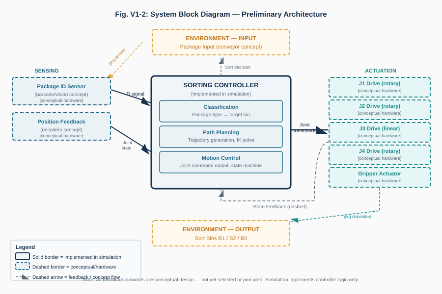
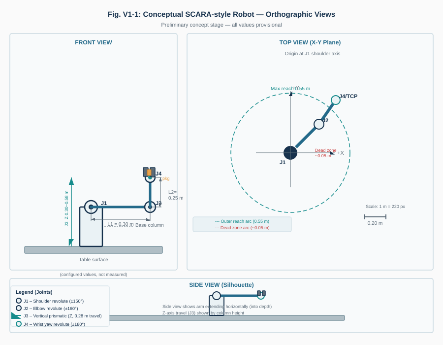
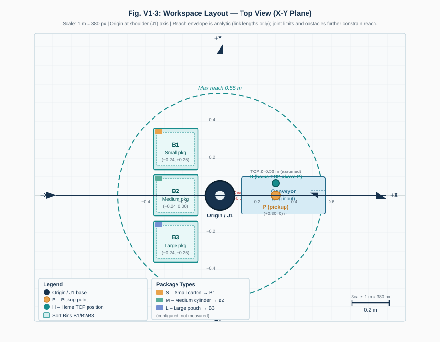

# Automated Warehouse Package Sorting Robot
## Week 1 — Concept Design Review (Version 1.0)

**Course:** Robotics, BCA UG, Semester VII  
**Project choice:** Option 01 — Automated Warehouse Package Sorting Robot  
**Student:** [Student Name]  
**University registration / roll number:** [Student Roll Number]  
**Submission date:** [Submission Date]  
**Report type:** Individual, cumulative design workbook — concept milestone  
**Milestone window:** Friday–Sunday, 16–18 October 2026; use faculty-announced cut-off  
**Milestone weight:** 5 marks (of 25 total)  
**Week 1 rubric:** Problem and requirements (2); architecture and selection (2); preliminary feasibility (1)  
**System summary:** A fixed four-axis SCARA-style cell identifies a package category and transfers the package from a known infeed position to Bin A, B, or C using an electric parallel-jaw gripper.

> This is a design report. Existing project files contain a software workcell and simulation evidence, but no physical robot build or hardware test is claimed.

## Contents

1. Problem and design inputs  
2. Operating sequence and architecture  
3. Preliminary robot selection and workspace  
4. Hazards, benefits, and limits  
5. References and change log

## 1. Problem and design inputs

### Problem statement (131 words)

Warehouse orders often contain packages that must be separated by destination before downstream storage or dispatch. This project proposes a fixed robotic sorting cell for one package at a time. Each package arrives at a known infeed location and is assigned one of three categories: a small carton, a medium cylindrical container, or a larger lightweight pouch. A simplified identification input supplies the category to the controller; camera-based recognition is outside the present scope. A robot then approaches the package, grips it, lifts it clear of the support, transfers it to the mapped destination bin, releases it, and returns to a home position. The design focuses on a plausible reach envelope, mixed-package gripping, sensor-controller coordination, basic safeguards, and a measurable cycle-time target. Dimensions and masses are provisional design assumptions pending confirmation.

### Package and station assumptions

The brief gives example package types but leaves dimensions, masses, station coordinates, and cycle target to the student. Values below are taken from the existing SortLab project configuration and are treated as assumptions, not measured warehouse data. SI units are used. **S** means small carton, **M** medium cylinder, and **L** large pouch. Bin A/B/C correspond consistently to configured destinations B1/B2/B3.

**Table 1. Assumed package inputs and destination mapping**

| Category | Illustrative object | Assumed dimensions (L × W × H) | Assumed mass | Destination |
|---|---|---:|---:|---|
| S | Small carton | 0.08 × 0.06 × 0.04 m | 0.10 kg | Bin A (B1) |
| M | Cylindrical container (diameter × diameter × height proxy) | 0.12 × 0.09 × 0.06 m | 0.30 kg | Bin B (B2) |
| L | Lightweight pouch (rigid proxy for early geometry) | 0.16 × 0.12 × 0.08 m | 0.60 kg | Bin C (B3) |

**Assumptions:** The cylinder is represented by its maximum plan dimensions in this table. The pouch dimensions describe a rigid modelling envelope, not its flexible shape under grip. Packages are non-hazardous and arrive singly, aligned near a known center, indoors. No supplier specification or scale measurement was found in the workspace. The configured median cycle aspiration is 12 s; it is a target for later evaluation, not an achieved result.

**Table 2. Initial cell and robot specifications**

| Item | Preliminary design value | Status / note |
|---|---:|---|
| Cell type | Fixed tabletop sorting cell | Design choice |
| Package input | One known pickup center, P = (+0.30, 0.00) m | Assumption in frame W |
| Bin centers | A/B/C = (−0.24,+0.25), (−0.24,0), (−0.24,−0.25) m | Assumed layout in frame W |
| Table plane | z = 0.25 m | Assumed |
| Robot | SCARA-style, four independent axes | Preliminary choice |
| Links / nominal planar reach | L₁ = 0.30 m, L₂ = 0.25 m; ideal reach 0.05–0.55 m | Configured assumptions |
| Vertical motion | TCP z = 0.30–0.58 m; home z = 0.56 m | Configured travel envelope |
| Tool | Electric parallel jaws, 0.03–0.16 m opening | Conceptual; no selected hardware |
| Payload | Must handle the assumed 0.60 kg L package plus tool | Arm rating and margin not yet known |
| Power | Electric supply proposed | Voltage/current not selected |
| Cycle target | Median ≤12 s | Aspiration, to be evaluated |
| Safety | Guarded cell, access interlock, safe stop, package catch area | Proposed safeguards; not implemented |

## 2. Operating sequence and architecture

### Basic sequence

1. A package arrives at the known pickup position; the infeed is paused or presents only one package.
2. A sensor/label input assigns category S, M, or L. In the current software project, the operator selects this category; an actual camera or barcode reader is not present.
3. The controller maps S→A, M→B, or L→C and checks that a route is available.
4. The arm moves to the package approach pose, aligns and closes the parallel jaws.
5. Grip confirmation is required before the package is lifted vertically to clearance height.
6. The arm transfers above the cell to the selected bin and lowers to its placement pose.
7. The gripper opens; package placement is checked before the arm returns to home.
8. An unknown category, failed grip, blocked route, or uncertain placement stops the cycle and requests operator recovery rather than guessing.

### System architecture

**Figure 1. Labelled system architecture.** The referenced diagram exists in the project. Solid blocks/arrows describe software and simulation elements already present; dashed blocks are proposed physical hardware. It is not a wiring diagram or claim of built equipment.

### Preliminary system specification and requirements boundary

The cell needs category input, a controller, a motion mechanism, an end effector, power, and feedback. At concept stage, the category signal and package-placement feedback are abstract functions. For a physical cell, a barcode/label reader or other agreed sensor would provide the category; joint encoders and gripper state sensing would provide feedback. Electric rotary drives for the shoulder/elbow/wrist and a linear electric axis for vertical movement are proposed. Motors, gearboxes, controller, sensor models, supply ratings, and arm payload rating remain unselected. The current simulation must not be read as physical implementation of those blocks.

## 3. Preliminary robot selection and workspace

### Configuration comparison

**Table 3. Two plausible fixed-cell configurations**

| Configuration | Advantages for this task | Trade-offs / concerns | Week 1 assessment |
|---|---|---|---|
| Cartesian gantry (X, Y, Z with wrist rotation) | Straightforward rectangular workspace; axes and positions are easy to explain; vertical pick motion is direct | Requires overhead/side rails spanning stations; occupies a larger frame; three-axis coverage may need long travel | Feasible alternative, especially for a rectangular cell |
| SCARA-style R–R–P–R | Compact tabletop footprint; fast planar transfers with a vertical pick axis; simple two-link reach model; wrist yaw can align jaws | Annular reach and joint limits constrain layout; singular configurations and link clearance need checking | Preferred preliminary concept for three fixed nearby bins |

The SCARA-style concept is selected provisionally because all destinations are fixed and close to one known input point. It offers a compact arm layout and a teachable two-link planar model. The trade-off is a curved, joint-limited workspace; every station and transfer corridor must be checked before construction. No cost, speed, payload, or precision comparison is measured.

### Labelled concept and workspace

The planned V1 concept, system block, and workspace diagrams are present in `images-02/V1_Concept` and are reused below. Their labels identify provisional/configured values; none are measured hardware drawings.

**Figure 2. Preliminary four-axis robot anatomy (R–R–P–R).** J1/J2 rotate the planar links, J3 moves the tool vertically, and J4 rotates tool yaw. The 4-axis layout is preliminary; exact motor and bearing design is not specified.

**Figure 3. Preliminary workspace and station concept.** P, A/B/C, and home are shown in frame W. Reach guides are link-only and do not establish collision-free clearance.

The independent-axis estimate is four: J1 revolute, J2 revolute, J3 prismatic vertical, and J4 revolute tool yaw. This gives planar position, lift height, and in-plane tool orientation needed for package pickup and placement; it does not provide arbitrary six-dimensional tool pose. The configured home target is later formalized as joint position `(0, 0, 0.56 m, 0)` and is not treated as a measured pose.

**Preliminary reach check:** The ideal link-only radial reach is `|L₁−L₂|` to `L₁+L₂` = 0.05–0.55 m. The pickup is 0.30 m from the shoulder. The three bins are each approximately 0.347 m from it. Both lie inside the ideal radial interval. This is an initial geometry check only; joint limits, tool/package size, obstacles, and swept arm clearance remain to be verified.

## 4. Hazards, benefits, and limits

**Table 4. Initial hazards and proposed controls**

| Hazard | Possible consequence | Concept control | Limitation at this milestone |
|---|---|---|---|
| Arm or jaw pinch / unexpected movement | Hand injury during access or jam clearing | Enclose the cell; interlocked access; safe operating mode and independently rated stop | No guard, interlock, or safety-rated stop is built or validated |
| Package dropped or crushed | Impact injury or damaged goods | Confirm grip before lift; use force-limited jaws and a catch area; characterize package crush limits | Grip friction, contact force, and pouch deformation are not measured |
| Arm/package collision with bin, infeed, or person | Injury or damage | Separate people from motion; reserve a clearance route; perform a risk assessment and collision/stop validation | The preliminary route is not swept-volume checked; no people detection exists |

**Expected benefit:** Automating a repeated transfer could reduce routine manual sorting effort and provide consistent category-to-bin routing in a small cell.  
**Potential practical/social impact:** It could reduce repetitive handling exposure for an operator, while shifting work toward supervision and recovery. It also introduces pinch, dropped-load, maintenance, and job-change considerations; benefits depend on safe implementation and the operating context.

**Design limitations:** Package data and station coordinates are assumptions. No hardware components are selected or built. The category sensor is represented as a simplified input. Reach estimates are not collision or safety validation. A payload margin cannot yet be calculated because the arm structural rating and tool mass are unknown.

## 5. References and change log

### References

1. *Robotics — Individual Design Project*, BCA UG Semester VII course brief, Option 01, common minimum requirements, weekly deliverables, and assessment rubric. The supplied original was available as `Robotics Course Project Brief.docx` in Downloads; no PDF copy was present in the workspace.
2. SortLab project configuration, `src/engineering/config.ts`, and baseline notes, `docs/ENGINEERING-BASELINE.md` (assumed values only; accessed 18 October 2026).
3. Lynch, K. M., and Park, F. C., *Modern Robotics: Mechanics, Planning, and Control*, Cambridge University Press, 2017. DOI: [10.1017/9781316661239](https://doi.org/10.1017/9781316661239). Used for the general two-link robot terminology; numerical work is deferred to Week 2.

### Dated change log

| Date | Version | Change |
|---|---|---|
| 18 October 2026 | V1.0 | Defined the Option 01 cell, provisional S/M/L dimensions and masses, bin mapping, first-pass SCARA selection, architecture, operating sequence, workspace estimate, hazards, benefit, and open assumptions. |

**Diagram note:** The planned milestone-specific SVGs are present in `images-02/V1_Concept`, `V2_Engineering`, and `V3_Final`. This report links the relevant V1 concept, architecture, and workspace assets. No separate raster concept photograph or physical model was found.
