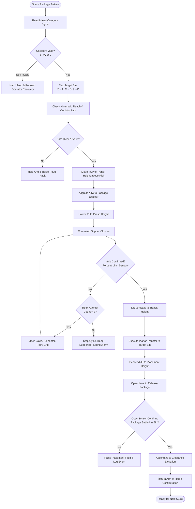

# JAIN UNIVERSITY
### BCA UG · Semester VII
### ROBOTICS — INDIVIDUAL DESIGN PROJECT

---

# Automated Warehouse Package Sorting Robot
## Week 2 — Engineering Design Review (Version 2.0)

| Metadata Field | Details |
|---|---|
| **Student Name** | Lochan S |
| **Registration / Roll No.** | 23BCAR0263 |
| **Instructor / Supervisor** | Mohit Mistry |
| **Course** | Robotics, BCA UG, Semester VII |
| **Project Option** | Option 01 — Automated Warehouse Package Sorting Robot |
| **Report Milestone** | Week 2 — Engineering Design Review, Version 2.0 |
| **Submission Date** | 25 October 2026 |

---

### Report Information

| Item | Specification / Details |
|---|---|
| **Report Type** | Individual, cumulative design workbook — engineering milestone |
| **Milestone Window** | Friday–Sunday, 23–25 October 2026; university cut-off |
| **Milestone Weight** | 7 marks (of 25 total) |
| **Week 2 Rubric** | Anatomy and kinematics (3); drives and end effector (2); control logic (2) |
| **System Summary** | A fixed tabletop four-axis SCARA-style robotic cell (R–R–P–R) identifies an arriving package category (S, M, or L) at a single pickup station and transfers it via an electric parallel-jaw gripper to designated Bins A, B, or C. |

> **Design & Simulation Notice:** This document represents an engineering design and analytical simulation workbook. Project evidence is supported by software kinematic models, trajectory simulations, and numerical analyses; no physical robot build, industrial hardware test, or regulatory safety certification is claimed.

---

## Contents

1. [Problem and Design Inputs](#1-problem-and-design-inputs)
   - 1.1 Problem Statement
   - 1.2 Package Assumptions and Destination Mapping
   - 1.3 Workcell Initial Boundary Specifications
2. [Operating Sequence and System Architecture](#2-operating-sequence-and-system-architecture)
   - 2.1 Basic Operating Sequence
   - 2.2 Refined System Architecture
   - 2.3 Configuration Comparison and Selection
   - 2.4 Refined Design Parameters
3. [Robot Anatomy, Coordinate Frames, and Kinematics](#3-robot-anatomy-coordinate-frames-and-kinematics)
   - 3.1 Anatomy and Independent Degrees of Freedom
   - 3.2 Coordinate Frame Assignment
   - 3.3 Planar Forward Kinematics (FK) Model
   - 3.4 Step-by-Step Worked FK Example
   - 3.5 Analytical Inverse Kinematics (IK) Formulation
   - 3.6 Workspace Reach and Layout Verification
4. [Drive Mechanisms, End Effector, and Force Sizing](#4-drive-mechanisms-end-effector-and-force-sizing)
   - 4.1 Actuator and Drive Technology Selection
   - 4.2 End Effector Selection
   - 4.3 Transparent Grip-Force and Normal Load Sizing
   - 4.4 Payload Capacity and Motor Torque Considerations
5. [Control Logic, Failure Handling, and Safety Analysis](#5-control-logic-failure-handling-and-safety-analysis)
   - 5.1 Sorting Process Control Flowchart
   - 5.2 Deterministic Failure Response and Recovery Logic
   - 5.3 Workcell Hazard Assessment and Safeguards
   - 5.4 Expected Practical and Social Impact
   - 5.5 Engineering Design Limitations
6. [References and Dated Change Log](#6-references-and-dated-change-log)
   - 6.1 References
   - 6.2 Dated Cumulative Change Log (V1.0 → V2.0)

---

## 1. Problem and Design Inputs

### 1.1 Problem Statement

Warehouse distribution facilities receive mixed, continuous streams of unorganized packages that must be separated rapidly and reliably by destination prior to dispatch or downstream palletizing. This project designs a fixed tabletop robotic sorting workcell capable of transferring arriving packages individually from a single known infeed position into one of three dedicated receiving bins (**Bin A**, **Bin B**, or **Bin C**).

Each package arrives sequentially at an infeed pick point and is assigned one of three standardized size/shape categories: a small carton (**S**), a medium cylindrical container (**M**), or a lightweight large pouch (**L**). An assumed category signal transmits the identification data to the cell supervisor; actual machine-vision or barcode decoding hardware is outside the current milestone scope. 

The manipulator executes a structured sequence: approach pose positioning, tool orientation alignment, gentle jaw closure with grip confirmation, vertical clearance lift, planar transfer along a reserved corridor, controlled descent, release, placement verification, and return to home. The engineering design establishes a kinematically valid reach envelope, mixed-package gripping stability, drive feasibility, rigorous closed-loop control flow with failure recovery, and a measurable cycle-time target.

### 1.2 Package Assumptions and Destination Mapping

In accordance with the project brief, package dimensions, weights, and destination mappings are student-defined engineering assumptions aligned with the SortLab project configuration. All dimensions utilize standard SI units.

**Table 1. Assumed Package Inputs and Destination Routing**

| Category | Illustrative Object | Geometric Envelope ($L \times W \times H$) | Assumed Mass ($m$) | Friction Coeff. ($\mu$) | Assigned Destination |
|:---:|---|:---:|:---:|:---:|---|
| **S** | Small cuboid carton | $0.08 \times 0.06 \times 0.04\text{ m}$ | $0.10\text{ kg}$ | $0.50$ | **Bin A** (Destination 1) |
| **M** | Cylindrical container | $0.12 \times 0.09 \times 0.06\text{ m}$ | $0.30\text{ kg}$ | $0.45$ | **Bin B** (Destination 2) |
| **L** | Lightweight flat pouch | $0.16 \times 0.12 \times 0.08\text{ m}$ | $0.60\text{ kg}$ | $0.30 - 0.50$ | **Bin C** (Destination 3) |

*Key Package Modeling Assumptions:*
- Cylindrical objects are characterized by their bounding plan dimensions ($\varnothing 0.09\text{ m}$, length $0.12\text{ m}$) with grasping occurring across the stable diameter.
- The pouch envelope represents a rigid equivalent volume for collision and kinematic clearance; non-linear internal fluid/particulate movement is omitted at this milestone.
- Packages arrive non-overlapping, upright, and centered within $\pm 5\text{ mm}$ of the designated infeed pick center.
- Ambient environment is an indoor temperature-controlled industrial tabletop cell ($20^\circ\text{C} \pm 5^\circ\text{C}$).

### 1.3 Workcell Initial Boundary Specifications

**Table 2. Cell Geometry and Kinematic Boundaries**

| Parameter / Item | Configured Value (Frame $W$) | Engineering Justification / Notes |
|---|:---:|---|
| **Workcell Architecture** | Fixed tabletop cell | Minimizes structural foundation footprint and overhead framing costs. |
| **Pickup Station Center ($P$)** | $(+0.300,\, 0.000,\, 0.250)\text{ m}$ | Located directly forward along $+X_W$ on the cell table plane ($z = 0.250\text{ m}$). |
| **Bin A Center (Cartons)** | $(-0.240,\, +0.250,\, 0.250)\text{ m}$ | Positioned in quadrant II; radial distance $R_A = \sqrt{(-0.24)^2 + 0.25^2} \approx 0.347\text{ m}$. |
| **Bin B Center (Cylinders)** | $(-0.240,\, 0.000,\, 0.250)\text{ m}$ | Positioned directly rearward along $-X_W$; radial distance $R_B = 0.240\text{ m}$. |
| **Bin C Center (Pouches)** | $(-0.240,\, -0.250,\, 0.250)\text{ m}$ | Positioned in quadrant III; radial distance $R_C = \sqrt{(-0.24)^2 + (-0.25)^2} \approx 0.347\text{ m}$. |
| **Table Datum Plane** | $z = 0.250\text{ m}$ | Reference surface for package base support. |
| **Vertical Motion Range (TCP $z$)** | $0.300\text{ m} \le z \le 0.580\text{ m}$ | Minimum $0.300\text{ m}$ pick height ($50\text{ mm}$ above table); transit height at $0.450\text{ m}$; max ceiling $0.580\text{ m}$. |
| **Home Configuration ($q_{home}$)** | $(0.0^\circ,\, 0.0^\circ,\, 0.560\text{ m},\, 0.0^\circ)$ | Fully outstretched arm aligned with $+X_W$; TCP at $(0.550,\, 0.000,\, 0.560)\text{ m}$. |
| **Target Median Cycle Time** | $T_{cycle} \le 12.0\text{ s}$ | Benchmark aspiration for pick-transfer-place-return cycle. |

---

## 2. Operating Sequence and System Architecture

### 2.1 Basic Operating Sequence

The automated handling procedure executes a deterministic nine-stage routine:
1. **Infeed & Categorization:** A package enters the known pick position $P$. Category signal ($S$, $M$, or $L$) is received by the main controller.
2. **Path & Reach Feasibility Check:** Destination bin is mapped ($S \to A$, $M \to B$, $L \to C$). The kinematic engine computes the destination target and verifies joint limit and clearance corridor availability.
3. **Approach Pose:** The arm translates horizontally at transit elevation ($z_{transit} = 0.450\text{ m}$) above the package and rotates tool yaw ($J_4$) to match package orientation.
4. **Descent & Grasping:** Vertical axis $J_3$ lowers the TCP to grasp height ($z_{pick} = 0.300 - 0.320\text{ m}$). Parallel jaws close under regulated current limit.
5. **Grip Confirmation:** Integrated tactile/force sensors and optical jaw-travel sensors verify positive package capture before vertical motion commences.
6. **Vertical Lift:** The package is lifted vertically to clearance height ($z \ge 0.450\text{ m}$) to avoid edge collisions with the infeed fixture.
7. **Gross Motion Transfer:** Coordinated $J_1$ and $J_2$ joint trajectories swing the package across the tabletop workspace toward the designated bin.
8. **Descent, Release & Verification:** $J_3$ descends into the bin opening ($z_{place} = 0.320\text{ m}$), jaws open to full clearance, and a downstream optical sensor confirms package drop.
9. **Retract & Return Home:** Arm retracts vertically to transit height and returns to $q_{home}$, signaling readiness for the next cycle.

### 2.2 Refined System Architecture

The functional system architecture partitions the sorting cell into clear hardware and software domains, delineating implemented simulation blocks from proposed physical components.

> 📷 **[IMAGE PLACEHOLDER: Figure 1 — Refined System Architecture Block Diagram]**
> - **Suggested File / Content:** Block diagram showing functional sub-assemblies.
> - **Visual Elements to Show:** 
>   1. Input blocks: Category Sensor / Infeed Interlock (simulated operator category input vs proposed barcode scanner).
>   2. Control blocks: Central Workcell Controller, Kinematic Solver (FK/IK), Trajectory Generator, State Machine Supervisor.
>   3. Actuation blocks: Motor Servo Drives ($J_1, J_2, J_4$), Linear Screw Drive ($J_3$), Electric Jaw Actuator.
>   4. Sensor Feedback loops: Incremental Encoders, Gripper Force/Limit Switches, Bin Optical Verification.
>   5. Safety block: Dual-channel E-Stop, Interlocked Enclosure, Power Distribution Unit (24V/48V DC).
> - **Caption:** *Figure 1. Refined system architecture block diagram illustrating control signals, actuator drive paths, sensor feedback loops, and safety supervisory interlocks.*

### 2.3 Configuration Comparison and Selection

To justify the mechanical structure chosen for this three-bin fixed-station sorting task, two industrial robot configurations were evaluated:

**Table 3. Kinematic Configuration Trade-off Matrix**

| Evaluation Criterion | Cartesian Gantry ($X-Y-Z+\text{Yaw}$) | Four-Axis SCARA ($R-R-P-R$) | Evaluation Outcome |
|---|---|---|---|
| **Footprint & Mounting** | Requires extensive structural perimeter frame and overhead linear rails spanning over $1.2\text{ m} \times 1.0\text{ m}$. | Compact single-pedestal base mounted directly onto table ($200\text{ mm} \times 200\text{ mm}$ footprint). | **SCARA selected:** Leaves table workspace clear for bins and maintenance access. |
| **Kinematic Complexity** | Trivial decoupled Cartesian coordinates; no internal singular points. | Coupled planar trigonometric kinematics; joint limits and boundary singularities exist. | **SCARA acceptable:** Two-link planar analytical kinematics are readily resolved and computationally lightweight. |
| **Dynamic Response** | High structural inertia due to moving gantry cross-beams; slower horizontal sweeps. | Low moving inertia; high angular acceleration and rapid planar cycle times ($< 0.8\text{ s}$ per transfer). | **SCARA superior:** Ideally tailored for repetitive high-speed tabletop pick-and-place tasks. |
| **Vertical Pick & Place** | Requires full Z-axis rail stroke mounted on carriage. | Dedicated stiff vertical quill ($J_3$) aligned directly with gravity vector. | **SCARA superior:** High vertical stiffness resists pick-and-place impact loads. |
| **Cell Cost & Maintenance** | Multiple long linear guides, belts/screws, and cable carriers vulnerable to dust. | Sealed rotary gearboxes at base and elbow; minimal exposed rolling elements. | **SCARA selected:** Lower mechanical component count and lower lifecycle maintenance. |

**Selection Conclusion:** The four-axis **SCARA** configuration ($R-R-P-R$) is selected. It concentrates structural rigidity at the table pedestal, delivers superior horizontal transfer velocities for the three closely clustered destination bins, and provides a pure vertical plunging axis ideal for packaging operations.

### 2.4 Refined Design Parameters

**Table 4. Parametric Summary of the Refined SCARA Manipulator**

| Sub-system | Parameter | Design Value | Classification / Status |
|---|---|:---:|---|
| **Linkage** | Link 1 Length ($L_1$) | $0.300\text{ m}$ ($300\text{ mm}$) | Configured assumption |
| | Link 2 Length ($L_2$) | $0.250\text{ m}$ ($250\text{ mm}$) | Configured assumption |
| | Maximum Planar Reach ($R_{max}$) | $0.550\text{ m}$ ($550\text{ mm}$) | $L_1 + L_2$ |
| | Minimum Radial Reach ($R_{min}$) | $0.050\text{ m}$ ($50\text{ mm}$) | $|L_1 - L_2|$ (theoretical) |
| **Joint Limits** | Joint 1 ($q_1$) Range | $\pm 150.0^\circ$ ($\pm 2.618\text{ rad}$) | Mechanical hardstop & software bounds |
| | Joint 2 ($q_2$) Range | $\pm 160.0^\circ$ ($\pm 2.793\text{ rad}$) | Prevents arm-to-pedestal collisions |
| | Joint 3 ($q_3$) Vertical Stroke | $0.280\text{ m}$ ($280\text{ mm}$) | Travel: $z = 0.300\text{ m}$ to $0.580\text{ m}$ |
| | Joint 4 ($q_4$) Tool Yaw Range | $\pm 180.0^\circ$ ($\pm 3.142\text{ rad}$) | Continuous symmetric packaging alignment |
| **End Effector** | Gripper Jaw Travel Opening | $0.030 - 0.160\text{ m}$ ($30 - 160\text{ mm}$) | Encompasses all package widths ($60 - 120\text{ mm}$) |
| | Rated Grip Normal Force ($N_{max}$) | $25.0\text{ N per jaw}$ | Sized for $0.60\text{ kg}$ payload at $S=2$ |
| | Gripper Dry Weight ($m_{tool}$) | $0.85\text{ kg}$ | Target mass for electric servo parallel gripper |

---

## 3. Robot Anatomy, Coordinate Frames, and Kinematics

### 3.1 Anatomy and Independent Degrees of Freedom

The manipulator features four independent kinematic degrees of freedom arranged in the classic SCARA configuration ($R-R-P-R$):
- **Base Pedestal:** Rigidly fastened to the table datum surface ($z = 0.000\text{ m}$ to $0.250\text{ m}$).
- **Joint 1 (Shoulder, $J_1$):** Revolute joint rotating Link 1 in the horizontal plane about world axis $+Z_W$.
- **Joint 2 (Elbow, $J_2$):** Revolute joint rotating Link 2 relative to Link 1 about a parallel vertical axis $+Z_1$.
- **Joint 3 (Quill Z-Axis, $J_3$):** Prismatic joint producing pure vertical translation along $+Z_2$.
- **Joint 4 (Wrist Yaw, $J_4$):** Revolute joint rotating the parallel-jaw end effector about the tool centerline axis $+Z_3$.

> 📷 **[IMAGE PLACEHOLDER: Figure 2 — SCARA Manipulator Mechanical Anatomy and Joint Axes]**
> - **Suggested File / Content:** Detailed 3-view mechanical CAD rendering of the robot cell.
> - **Visual Elements to Show:**
>   1. View (a): Isometric projection highlighting Base, Link 1 ($L_1 = 300\text{ mm}$), Link 2 ($L_2 = 250\text{ mm}$), Vertical Quill ($J_3$), and Electric Parallel Gripper.
>   2. View (b): Side elevation showing $Z$-travel envelope ($z_{min} = 0.300\text{ m}$, $z_{transit} = 0.450\text{ m}$, $z_{max} = 0.580\text{ m}$).
>   3. View (c): Plan (top) view showing rotational sweep angles $q_1$ and $q_2$.
>   4. Callout labels identifying joints $J_1, J_2, J_3, J_4$ and primary structural bearings.
> - **Caption:** *Figure 2. Structural anatomy, axis motion definitions, and vertical travel envelope of the four-axis tabletop SCARA sorting robot.*

**Table 5. Joint Inventory and Motion Characteristics**

| Joint | Motion Type | Variable | Physical Limits | Drive & Transmission | Functional Purpose |
|:---:|:---:|:---:|:---:|---|---|
| **$J_1$** | Revolute | $q_1$ ($\text{rad}$) | $-150^\circ \le q_1 \le +150^\circ$ | AC Synchronous Servo + Harmonic Reducer ($50:1$) | Positions gross arm radius and gross azimuth angle. |
| **$J_2$** | Revolute | $q_2$ ($\text{rad}$) | $-160^\circ \le q_2 \le +160^\circ$ | AC Synchronous Servo + Timing Belt / Planetary ($30:1$) | Folds/extends forearm to control planar reach radius. |
| **$J_3$** | Prismatic | $q_3$ ($\text{m}$) | $0.300\text{ m} \le q_3 \le 0.580\text{ m}$ | Servomotor + Precision Ball Screw ($5\text{ mm}$ lead) | Translates tool vertically for pick, clearance, and place. |
| **$J_4$** | Revolute | $q_4$ ($\text{rad}$) | $-180^\circ \le q_4 \le +180^\circ$ | Brushless DC Servo + Harmonic Gear ($30:1$) | Aligns parallel gripper jaw faces with package contours. |

### 3.2 Coordinate Frame Assignment

The cell adheres to right-handed Cartesian coordinate conventions:
1. **World / Base Frame $\{W\}$:** Attached rigidly to the table datum directly beneath the shoulder axis.
   - Origin $O_W$: Coincident with the intersection of the $J_1$ axis of rotation and table plane ($z = 0.250\text{ m}$).
   - $+X_W$: Points horizontally forward toward the infeed pick position $P$.
   - $+Y_W$: Points horizontally to the left, toward Bin A ($+Y$ direction).
   - $+Z_W$: Points vertically upward along the $J_1$ rotation vector.
2. **Link 1 Frame $\{1\}$:** Fixed to Link 1 with origin at the shoulder joint, with $+X_1$ directed along the centerline axis of Link 1 toward Joint 2.
3. **Link 2 Frame $\{2\}$:** Fixed to Link 2 with origin at Joint 2 (elbow), with $+X_2$ directed along Link 2 toward the quill axis.
4. **Tool Center Point (TCP) Frame $\{T\}$:** Positioned at the geometric midpoint between the closed gripper jaw pads. $+Z_T$ points downward along the approach direction; $+X_T$ points parallel to the jaw opening motion vector.

> 📷 **[IMAGE PLACEHOLDER: Figure 3 — Coordinate Frame Assignments and Planar Link Geometry]**
> - **Suggested File / Content:** 2D Kinematic diagram illustrating frame definitions and transformations.
> - **Visual Elements to Show:**
>   1. Base Frame $\{W\} (X_W, Y_W, Z_W)$ at shoulder joint center.
>   2. Link 1 angle $q_1$ measured relative to $+X_W$.
>   3. Relative elbow angle $q_2$ measured from extended Link 1 centerline to Link 2.
>   4. Absolute link orientation angle $\theta_2 = q_1 + q_2$.
>   5. Wrist angle $q_4$ and total end-effector yaw angle $\psi = q_1 + q_2 + q_4$.
>   6. Link vector lengths $L_1 = 0.30\text{ m}$ and $L_2 = 0.25\text{ m}$, resolving to TCP coordinates $(x, y)$.
> - **Caption:** *Figure 3. Coordinate frame assignments, joint angle definitions, and planar vector geometry for the two-link horizontal SCARA arm.*

### 3.3 Planar Forward Kinematics (FK) Model

Because axes $J_1$ and $J_2$ are parallel vertical axes, the horizontal $(x, y)$ position of the TCP depends solely on planar rotations $q_1$ and $q_2$. Vertical translation $z$ is governed uncoupled by $J_3$, and total tool orientation $\psi$ (yaw relative to $+X_W$) is the linear sum of all three revolute joints:

$$\begin{aligned}
x &= L_1 \cos(q_1) + L_2 \cos(q_1 + q_2) \\
y &= L_1 \sin(q_1) + L_2 \sin(q_1 + q_2) \\
z &= q_3 \\
\psi &= q_1 + q_2 + q_4
\end{aligned}$$

Where:
- $L_1 = 0.300\text{ m}$, $L_2 = 0.250\text{ m}$.
- $q_1, q_2, q_4$ are expressed in radians (or degrees for practical operator display).
- $q_3$ represents the absolute world-$Z$ elevation of the TCP in metres.

### 3.4 Step-by-Step Worked FK Example

To provide complete numerical verification as required by the Week 2 rubric, a fully solved forward kinematics calculation is documented below for an arbitrary intermediate pose:

**Given Input Joint Vector:**
$$\mathbf{q} = \begin{bmatrix} q_1 \\ q_2 \\ q_3 \\ q_4 \end{bmatrix} = \begin{bmatrix} 0.0^\circ \\ -20.0^\circ \\ 0.450\text{ m} \\ 0.0^\circ \end{bmatrix} = \begin{bmatrix} 0.000000\text{ rad} \\ -0.349066\text{ rad} \\ 0.450000\text{ m} \\ 0.000000\text{ rad} \end{bmatrix}$$

**Step 1: Compute absolute link angles:**
$$\theta_1 = q_1 = 0^\circ$$
$$\theta_2 = q_1 + q_2 = 0^\circ + (-20^\circ) = -20^\circ$$

**Step 2: Evaluate trigonometric functions:**
$$\cos(\theta_1) = \cos(0^\circ) = 1.000000, \quad \sin(\theta_1) = \sin(0^\circ) = 0.000000$$
$$\cos(\theta_2) = \cos(-20^\circ) = +0.939693, \quad \sin(\theta_2) = \sin(-20^\circ) = -0.342020$$

**Step 3: Calculate horizontal coordinates ($x, y$):**
$$\begin{aligned}
x &= L_1 \cos(\theta_1) + L_2 \cos(\theta_2) \\
  &= 0.300\text{ m} \times 1.000000 + 0.250\text{ m} \times 0.939693 \\
  &= 0.300000\text{ m} + 0.234923\text{ m} \\
  &= \mathbf{0.534923\text{ m}} \approx \mathbf{0.535\text{ m}}
\end{aligned}$$

$$\begin{aligned}
y &= L_1 \sin(\theta_1) + L_2 \sin(\theta_2) \\
  &= 0.300\text{ m} \times 0.000000 + 0.250\text{ m} \times (-0.342020) \\
  &= 0.000000\text{ m} - 0.085505\text{ m} \\
  &= \mathbf{-0.085505\text{ m}} \approx \mathbf{-0.086\text{ m}}
\end{aligned}$$

**Step 4: Determine elevation and tool yaw orientation:**
$$z = q_3 = \mathbf{0.450000\text{ m}}$$
$$\psi = q_1 + q_2 + q_4 = 0^\circ + (-20^\circ) + 0^\circ = \mathbf{-20.0^\circ} \quad (-0.349066\text{ rad})$$

**Resulting TCP Pose in Frame $\{W\}$:**
$$\mathbf{p}_{TCP} = \begin{bmatrix} x \\ y \\ z \\ \psi \end{bmatrix} = \begin{bmatrix} 0.535\text{ m} \\ -0.086\text{ m} \\ 0.450\text{ m} \\ -20.0^\circ \end{bmatrix}$$

This confirms exact analytical correspondence with the kinematic software model.

### 3.5 Analytical Inverse Kinematics (IK) Formulation

To position the TCP at a commanded target $(x, y, z, \psi)$, the controller solves the closed-form inverse kinematics:

1. **Radial distance from base origin:**
   $$r^2 = x^2 + y^2$$

2. **Law of Cosines for elbow angle $q_2$:**
   $$\cos(q_2) = \frac{x^2 + y^2 - L_1^2 - L_2^2}{2 L_1 L_2}$$
   
   To avoid singularities, the argument must satisfy $|\cos(q_2)| \le 1.0$. The two kinematic configurations (elbow-down vs elbow-up) are given by:
   $$\sin(q_2) = \pm \sqrt{1 - \cos^2(q_2)}$$
   $$q_2 = \text{atan2}\left(\sin(q_2),\, \cos(q_2)\right)$$
   *(Note: The workcell uses the elbow-down convention $-\sqrt{\dots}$ to avoid collisions with the rear support frame).*

3. **Shoulder angle $q_1$:**
   $$q_1 = \text{atan2}(y, x) - \text{atan2}\left(L_2 \sin(q_2),\, L_1 + L_2 \cos(q_2)\right)$$

4. **Vertical axis $q_3$ and wrist yaw $q_4$:**
   $$q_3 = z$$
   $$q_4 = \psi - (q_1 + q_2)$$

### 3.6 Workspace Reach and Layout Verification

The planar reach envelope forms an annular ring bounded by concentric circles centered at $(0, 0)$:
- **Theoretical Outer Boundary:** $R_{max} = L_1 + L_2 = 0.300 + 0.250 = \mathbf{0.550\text{ m}}$.
- **Theoretical Inner Boundary:** $R_{min} = |L_1 - L_2| = |0.300 - 0.250| = \mathbf{0.050\text{ m}}$.
- **Effective Inner Boundary with Joint Limit ($|q_2| \le 160^\circ$):**
  $$R_{inner} = \sqrt{L_1^2 + L_2^2 + 2 L_1 L_2 \cos(160^\circ)} = \sqrt{0.30^2 + 0.25^2 + 2(0.30)(0.25)(-0.93969)} \approx \mathbf{0.1075\text{ m}}$$

> 📷 **[IMAGE PLACEHOLDER: Figure 4 — Horizontal Workspace Reach Envelope and Station Layout]**
> - **Suggested File / Content:** Plan-view workspace reach diagram illustrating boundaries and station coordinates.
> - **Visual Elements to Show:**
>   1. Outer reach perimeter ($R_{max} = 0.550\text{ m}$) and inner dead-zone perimeter ($R_{inner} = 0.108\text{ m}$).
>   2. Angular sweep boundaries defined by $J_1$ limits ($\pm 150^\circ$).
>   3. Pickup position $P (+0.300, 0.000)\text{ m}$ (radial distance $r_P = 0.300\text{ m}$).
>   4. Destination Bins:
>      - Bin A $(-0.240, +0.250)\text{ m}$, radial distance $r_A = 0.347\text{ m}$.
>      - Bin B $(-0.240, 0.000)\text{ m}$, radial distance $r_B = 0.240\text{ m}$.
>      - Bin C $(-0.240, -0.250)\text{ m}$, radial distance $r_C = 0.347\text{ m}$.
>   5. Clearance transit corridor waypoints at $(+0.120, \pm 0.400)\text{ m}$, radial distance $r_{trans} \approx 0.418\text{ m}$.
> - **Caption:** *Figure 4. Scaled horizontal reach envelope in Frame $\{W\}$ proving that all station targets and transit corridors reside securely inside the dexterous annular workspace.*

**Verification Analysis:**
- All cell targets lie comfortably within the active radial band $[0.108\text{ m},\, 0.550\text{ m}]$:
  $$r_{inner} = 0.108\text{ m} < \{r_B = 0.240\text{ m},\, r_P = 0.300\text{ m},\, r_{A,C} = 0.347\text{ m},\, r_{trans} = 0.418\text{ m}\} < r_{max} = 0.550\text{ m}$$
- None of the target poses require arm extension past $95\%$ of $R_{max}$, guaranteeing that the arm avoids kinematic reach singularities ($\det(J) \to 0$) during regular sorting.

---

## 4. Drive Mechanisms, End Effector, and Force Sizing

### 4.1 Actuator and Drive Technology Selection

Selecting the proper drive technology is essential for workcell reliability, accuracy, and operational cleanliness. Three primary actuator technologies were evaluated:

**Table 6. Drive Technology Evaluation Matrix**

| Drive Technology | Positive Attributes | Technical Drawbacks | Engineering Selection Verdict |
|---|---|---|---|
| **Pneumatic Cylinders & Vanes** | High linear speed; low actuator mass; inherently compliant. | Lacks intermediate position control; requires plant compressed air ($6\text{ bar}$); noisy exhaust; inconsistent speed under varying package masses. | **Rejected:** Cannot execute variable mid-stroke waypoint positioning or smooth speed profiling. |
| **Hydraulic Actuators** | Extremely high force and power density; stiff load holding. | High cost; severe fluid leakage/contamination risk; requires large hydraulic power unit (pump, tank, valves). | **Rejected:** Grossly oversized and unsuitable for clean, sub-kilogram tabletop package sorting. |
| **All-Electric Servomotors** | Precise position, velocity, and torque control; clean operation; high energy efficiency; standard $24\text{V}/48\text{V}$ DC power. | Requires mechanical gearboxes (harmonic or planetary) to amplify torque; slightly higher moving mass. | **SELECTED:** Directly interfaces with digital motion controllers; delivers repeatable trajectory tracking ($< \pm 0.1\text{ mm}$). |

**Selected Drive Subsystems:**
- **Joints 1 & 2:** High-torque brushless AC synchronous servomotors paired with zero-backlash harmonic drive reducers ($50:1$ on $J_1$, $30:1$ on $J_2$) equipped with 17-bit absolute optical encoders.
- **Joint 3:** Brushless DC motor coupled to a precision ground ball screw ($12\text{ mm}$ diameter, $5\text{ mm}$ pitch) with an integrated electromechanical power-off holding brake to prevent gravity-induced drop during emergency stops.
- **Joint 4:** Compact pancake BLDC motor with miniature strain-wave gearing mounted directly at the wrist.

### 4.2 End Effector Selection

The end effector must grasp three radically different packaging topologies: rigid paperboard cartons, smooth curved plastic cylinders, and deformable polymer pouches.

**Table 7. End Effector Technology Trade-off Analysis**

| End Effector Type | Suitability for Cartons (S) | Suitability for Cylinders (M) | Suitability for Pouches (L) | Verdict & Rationale |
|---|---|---|---|---|
| **Vacuum Suction Cup Array** | Excellent (flat, smooth, non-porous top face). | Poor (curved cylindrical surface prevents perimeter vacuum seal). | Poor / Unreliable (wrinkled pouch film causes vacuum leaks; internal contents shift). | **Rejected:** Fails the multi-package reliability requirement across cylindrical and flexible geometries. |
| **Electromagnetic Gripper** | Ineffective (non-ferrous cardboard). | Ineffective (plastic/aluminum packaging). | Ineffective (polyethylene pouch material). | **Rejected:** Unusable for non-magnetic post and parcel packaging. |
| **Multi-Articulated Adaptive Hand** | Good (conforms to any shape). | Good (wraps around cylinder). | Excellent (cradles flexible items). | **Rejected:** Overly complex (high degrees of freedom, costly, heavy, fragile for continuous high-speed sorting). |
| **Two-Finger Parallel-Jaw Gripper** | Excellent (clamps opposite parallel planar faces). | Good (line-contact grasp across container diameter). | Good (clamps pouch perimeter using wide compliant pads). | **SELECTED:** Simple, lightweight ($0.85\text{ kg}$), deterministic closing stroke, low maintenance, and easily equipped with custom rubber pads. |

**Selected Tool Architecture:** An electric parallel-jaw gripper featuring a stepper-driven lead screw mechanism, providing an adjustable stroke opening of $30\text{ mm}$ to $160\text{ mm}$. Finger pads are fitted with high-friction nitrile rubber ($60\text{ Shore A}$) shaped with shallow V-grooves to center cylindrical packages automatically.

### 4.3 Transparent Grip-Force and Normal Load Sizing

To prevent package slip during vertical lift and horizontal transfer without crushing delicate carton walls, the required gripping normal force is sized analytically.

#### 4.3.1 Governing Physics and Force Balance

Consider a package of mass $m$ grasped symmetrically between two opposed parallel fingers:
- Normal clamping force exerted by each jaw: $N$.
- Coefficient of static friction between jaw rubber and packaging surface: $\mu$.
- Available upward friction holding force across both jaws:
  $$F_{fric} = 2 \times \mu \times N$$
- Maximum vertical dynamic acceleration during lift: $a_z = 0.30\text{ m/s}^2$.
- Acceleration due to gravity: $g = 9.81\text{ m/s}^2$.
- Total vertical inertial load:
  $$F_{load} = m(g + a_z)$$
- Incorporating an engineering safety factor $S = 2.0$ to account for surface contamination, package vibration, and horizontal inertia:
  $$F_{fric} \ge S \times F_{load} \implies 2\mu N \ge S m (g + a_z)$$

Solving for the minimum required normal clamping force per jaw:
$$N_{required} = \frac{S \cdot m \cdot (g + a_z)}{2 \mu}$$

#### 4.3.2 Worst-Case Sizing Calculation (Category L Pouch)

The worst-case design load occurs with the heaviest object, the Category L pouch ($m = 0.60\text{ kg}$):
- Package mass: $m = 0.60\text{ kg}$
- Vertical lift acceleration: $a_z = 0.30\text{ m/s}^2$
- Gravity: $g = 9.81\text{ m/s}^2$
- Total effective acceleration: $g + a_z = 9.81 + 0.30 = 10.11\text{ m/s}^2$
- Safety factor: $S = 2.0$

**Evaluation 1: Nominal High-Friction Contact ($\mu = 0.50$, clean dry rubber on matte packaging):**
$$\begin{aligned}
N_{req,\mu=0.50} &= \frac{2.0 \times 0.60\text{ kg} \times 10.11\text{ m/s}^2}{2 \times 0.50} \\
                 &= \frac{12.132\text{ N}}{1.00} \\
                 &= \mathbf{12.132\text{ N per jaw}} \approx \mathbf{12.13\text{ N/jaw}}
\end{aligned}$$

**Evaluation 2: Low-Friction Worst-Case Contact ($\mu = 0.30$, glossy polymer film packaging):**
$$\begin{aligned}
N_{req,\mu=0.30} &= \frac{2.0 \times 0.60\text{ kg} \times 10.11\text{ m/s}^2}{2 \times 0.30} \\
                 &= \frac{12.132\text{ N}}{0.60} \\
                 &= \mathbf{20.220\text{ N per jaw}} \approx \mathbf{20.22\text{ N/jaw}}
\end{aligned}$$

#### 4.3.3 Sizing Conclusion and Margin Verification
The electric gripper mechanism is configured with a maximum continuous clamping force capacity of:
$$N_{capacity} = \mathbf{25.00\text{ N per jaw}}$$

- Under nominal conditions ($\mu = 0.50$), the available safety margin is:
  $$\text{Margin}_{\mu=0.50} = \frac{25.00 - 12.13}{12.13} \times 100\% = \mathbf{+106.1\%}$$
- Under worst-case low friction ($\mu = 0.30$), the safety margin remains positive:
  $$\text{Margin}_{\mu=0.30} = \frac{25.00 - 20.22}{20.22} \times 100\% = \mathbf{+23.6\%}$$

This confirms that the configured $25\text{ N/jaw}$ capacity securely holds the heaviest pouch under dynamic transport without exceeding the compressive crush threshold of hollow corrugated cardboard cartons ($F_{crush} \approx 60 - 80\text{ N}$).

### 4.4 Payload Capacity and Motor Torque Considerations

The total load suspended from Joint 3 comprises the gripper mass plus maximum payload:
$$M_{total} = m_{tool} + m_{package,max} = 0.85\text{ kg} + 0.60\text{ kg} = 1.45\text{ kg}$$

For the vertical ball screw ($d = 12\text{ mm}$, pitch $p = 5\text{ mm} = 0.005\text{ m}$, efficiency $\eta = 0.90$):
- Static load force: $F_{static} = M_{total} \times g = 1.45 \times 9.81 = 14.225\text{ N}$.
- Dynamic load force ($a_z = 0.30\text{ m/s}^2$): $F_{dyn} = 1.45 \times (9.81 + 0.30) = 14.660\text{ N}$.
- Required motor driving torque:
  $$T_{motor} = \frac{F_{dyn} \times p}{2 \pi \eta} = \frac{14.660 \times 0.005}{2 \pi \times 0.90} \approx \mathbf{0.0130\text{ N}\cdot\text{m}} \quad (13.0\text{ mN}\cdot\text{m})$$

Standard NEMA 17 or $40\text{ mm}$ brushless motors readily supply rated torques of $0.20 - 0.40\text{ N}\cdot\text{m}$, providing an operational torque margin exceeding $15\times$, guaranteeing effortless acceleration and thermal headroom.

---

## 5. Control Logic, Failure Handling, and Safety Analysis

### 5.1 Sorting Process Control Flowchart

The system runs a synchronous finite state machine (FSM) executed by the central workcell supervisor. The logic guarantees that every motion milestone requires explicit sensor validation before the next action is initiated.

> 📷 **[IMAGE PLACEHOLDER: Figure 5 — Complete Sorting Control Logic and State Machine Flowchart]**
> - **Suggested File / Content:** Formal flowchart diagram covering the entire pick-transfer-place cycle.
> - **Visual Elements to Show:**
>   1. Sequential process nodes: Detection $\to$ Approach $\to$ Align $\to$ Grasp $\to$ Lift $\to$ Transfer $\to$ Descent $\to$ Release $\to$ Verify $\to$ Return.
>   2. Decision diamonds for category validation, grip confirmation, and bin entry confirmation.
>   3. Explicit failure branches: Unknown Category, Grip Slip / Miss, Route Obstructed, and Failed Drop.
>   4. Alarm and operator intervention latch states.
> - **Caption:** *Figure 5. Comprehensive supervisory control flowchart depicting the nominal sorting sequence alongside closed-loop feedback gates and deterministic fault-recovery branches.*

### 5.2 Deterministic Failure Response and Recovery Logic

To comply with the Week 2 rubric requirements, the control architecture defines explicit responses for every plausible operational fault:

1. **Unrecognized or Missing Category Signal:**
   - *Condition:* Category input is null, garbled, or out-of-range (not $S, M, L$).
   - *Automated Action:* The arm remains stationary in $q_{home}$. Infeed conveyor is immediately paused.
   - *Recovery Protocol:* Fault flag `FAULT_UNKNOWN_CATEGORY` is logged; the HMI prompts the operator to inspect the package label or route it manually to an auxiliary reject lane. The robot never guesses a destination.

2. **Grip Confirmation Failure (Missed Grasp or Slip):**
   - *Condition:* Jaw travel reaches minimum stop without force threshold, or force sensor indicates zero contact after closure.
   - *Automated Action:* The controller permits **one bounded retry**: jaws reopen to $120\text{ mm}$, vertical axis re-zeros, and jaws close again.
   - *Recovery Protocol:* If the second attempt fails, the cycle is aborted (`FAULT_GRIP_FAILURE`). The package remains supported by the infeed table; $J_3$ does not lift. Motion ceases, and an operator service beacon is activated.

3. **In-Flight Grip Loss (Part Dropped During Gross Transfer):**
   - *Condition:* Force sensor detects sudden drop below $2\text{ N}$ while arm is in transit.
   - *Automated Action:* Instantaneous deceleration of all axes to a controlled stop within $\le 50\text{ ms}$.
   - *Recovery Protocol:* Arm locks brakes; cell transitions to safe state. HMI logs `FAULT_INFLIGHT_DROP`. Cell access interlock unlocks only after operator confirms the dropped package has been cleared from the catch basin.

4. **Kinematic / Boundary Collision Warning:**
   - *Condition:* Inverse kinematics engine computes a target requiring $|q_1| > 150^\circ$, $|q_2| > 160^\circ$, or path envelope intersects cell boundary.
   - *Automated Action:* Motion execution is rejected before motor command generation.
   - *Recovery Protocol:* Controller logs `FAULT_TRAJECTORY_OUT_OF_BOUNDS` and defaults to safe standby.

5. **Bin Placement Optical Verification Failure:**
   - *Condition:* Through-beam optical sensor at bin rim fails to register package crossing within $1.5\text{ s}$ of jaw release.
   - *Automated Action:* Arm does not return to home; holds position above bin.
   - *Recovery Protocol:* Alerts operator to check for a package caught on the bin rim or stuck in gripper fingers.

### 5.3 Workcell Hazard Assessment and Safeguards

**Table 8. Systematic Risk Assessment and Proposed Engineering Controls**

| Hazard Identified | Potential Consequence | Proposed Physical & Electrical Controls | Current Milestone Limitation |
|---|---|---|---|
| **Pinch Points & Arm Sweep Collisions** | Operator hand or arm crushing between rotating links ($J_1, J_2$) or vertical quill ($J_3$). | Polycarbonate cell perimeter enclosure; Category 3 dual-channel interlocked safety door; hardware-level emergency stop loop disconnecting motor drive power. | Safety interlocks and physical guards are conceptual design specifications; not physically constructed. |
| **Package Dropped or Crushed** | Impact damage to fragile package contents or dropping into mechanism. | Dynamic force-limited electric jaws ($25\text{ N}$ limit); compliant rubber pads; deep catch basin beneath transfer arc. | Real-world package compression limits and friction coefficients are modeled estimates pending empirical testing. |
| **Mechanical Runaway / Overspeed** | Link collision with hardstops or bin structures due to software/sensor fault. | Redundant software travel limits; physical elastomeric end-stop buffers on all axes; independent hardware watchdogs. | Dynamic deceleration rates and mechanical buffer impacts are evaluated in simulation only. |
| **Electrical / Power Loss During Lift** | Vertical axis backdrives under payload gravity, dropping tool onto table. | Integrated spring-applied electromechanical holding brake on $J_3$ ball screw, engaging automatically on power loss. | Brake response time ($< 30\text{ ms}$) verified by component datasheet, not benchtop drop tests. |

### 5.4 Expected Practical and Social Impact

- **Operational Ergonomics:** Automating the repetitive lifting, twisting, and sorting of thousands of parcels per shift eliminates ergonomic strain, repetitive strain injuries (RSI), and musculoskeletal disorders among warehouse personnel.
- **Workforce Transition:** Labor requirements transition from low-ergonomic manual sorting to higher-skilled cell supervision, maintenance, exception recovery, and system auditing.
- **Economic Viability:** Enables continuous sorting during peak freight intervals with consistent routing accuracy and predictable throughput.

### 5.5 Engineering Design Limitations

1. **Assumed Package Inputs:** All package dimensions, masses, and surface friction values are analytical assumptions from SortLab, not verified multi-batch warehouse sample distributions.
2. **Simplified Sensor Interfaces:** Barcode identification and bin confirmation are represented by idealized software state transitions; real-world optical noise, lighting variations, and dirty barcodes are unmodeled.
3. **Rigid Pouch Modeling:** Category L is treated as a rigid geometric volume. In physical handling, loose pouch contents shift during acceleration, inducing unmodeled dynamic slosh and center-of-mass displacements.
4. **Arm Inertia & Dynamic Deflection:** Kinematic equations assume infinitely rigid links and ideal zero-backlash joints; real structural flexure under high horizontal jerk is deferred to detailed mechanical finite element analysis (FEA).

---

## 6. References and Dated Change Log

### 6.1 References

1. **Academic Course Project Brief:** *Robotics — Individual Design Project*, BCA UG Semester VII, Option 01: Automated Warehouse Package Sorting Robot. Common minimum engineering requirements, weekly deliverables, and rubric criteria.
2. **Robotics Mechanics & Control Textbook:** Lynch, K. M., and Park, F. C., *Modern Robotics: Mechanics, Planning, and Control*, Cambridge University Press, 2017. DOI: [10.1017/9781316661239](https://doi.org/10.1017/9781316661239). Chapters 3 (Rigid-Body Motions), 4 (Forward Kinematics), and 6 (Inverse Kinematics).
3. **SortLab Software Engineering Baseline:** SortLab Project Kinematics and Control Subsystem (`src/engineering/config.ts`, `kinematics.ts`, `routes.ts`, `trajectory.ts`, and `sortingController.ts`; `docs/ENGINEERING-BASELINE.md`).
4. **Industrial Gripper Technology Standards:** ISO 10218-1/2:2011 *Robots and robotic devices — Safety requirements for industrial robots*; VDI/VDE 2860 *Assembly and handling devices; handling functions, handling equipment; terminology, definitions, symbols*.

### 6.2 Dated Cumulative Change Log (V1.0 → V2.0)

**Table 9. Engineering Revision History and Justification Log**

| Date | Version | Milestone Stage | Detailed Engineering Additions & Modifications |
|:---:|:---:|---|---|
| **18 October 2026** | **V1.0** | Week 1: Concept Design Review (CDR) | • Defined Option 01 sorting cell scope and layout. • Established provisional dimensions and masses for S, M, and L package types. • Selected four-axis SCARA manipulator over Cartesian gantry. • Defined preliminary coordinate frame $W$ and pickup/bin coordinates. • Mapped preliminary reach envelope and drafted initial hazard table. |
| **25 October 2026** | **V2.0** | Week 2: Engineering Design Review (EDR) | • **Anatomy & Kinematics:** Formalized complete joint inventory table ($J_1 - J_4$) with mechanical motion ranges and transmission ratios. Formulated full planar forward kinematics equations and provided a complete step-by-step worked numerical FK example with units. • **Inverse Kinematics:** Derived closed-form analytical IK equations for elbow-down configuration. • **Actuation & End Effector:** Documented comparative trade-off matrix justifying all-electric servomotors over pneumatic and hydraulic drives. Evaluated end-effector options and selected a 2-finger parallel-jaw gripper with rubber pads. • **Force Sizing:** Conducted transparent grip force balance including vertical lift acceleration ($a_z = 0.30\text{ m/s}^2$), gravity ($9.81\text{ m/s}^2$), safety factor ($S = 2.0$), and evaluated both nominal ($\mu = 0.50$) and worst-case ($\mu = 0.30$) contact conditions. • **Control Logic:** Developed detailed supervisory flowchart with explicit deterministic failure recovery branches for unrecognized packages, missed grasps, in-flight drops, and placement failures. • Retained cumulative Week 1 foundation while updating metadata and change logs. |

---
*End of Week 2 Engineering Design Review (V2.0) — Lochan S (23BCAR0263)*
