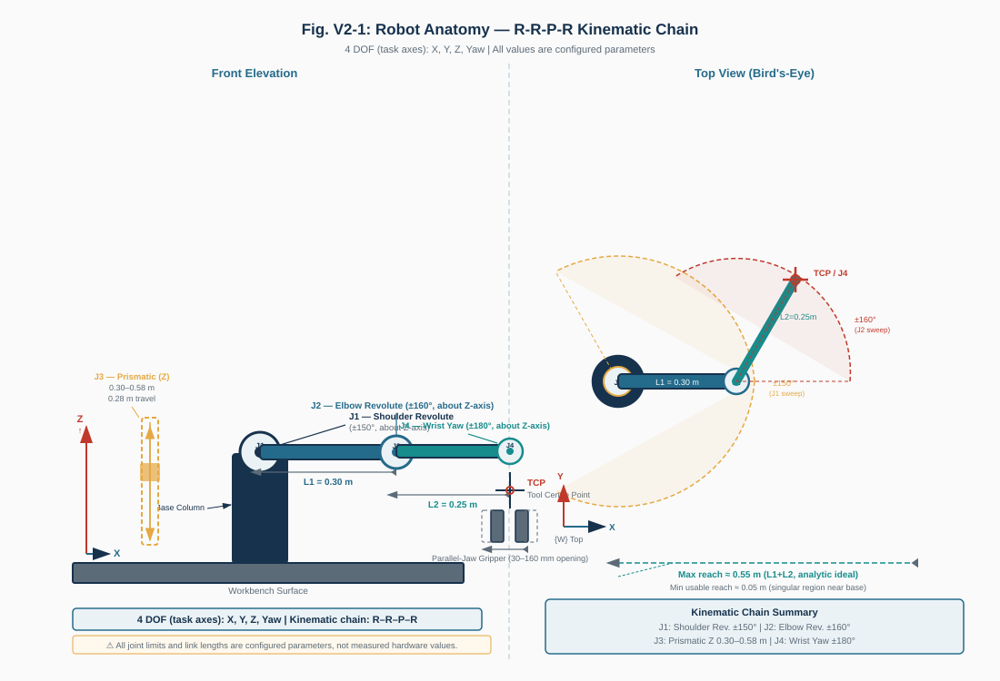
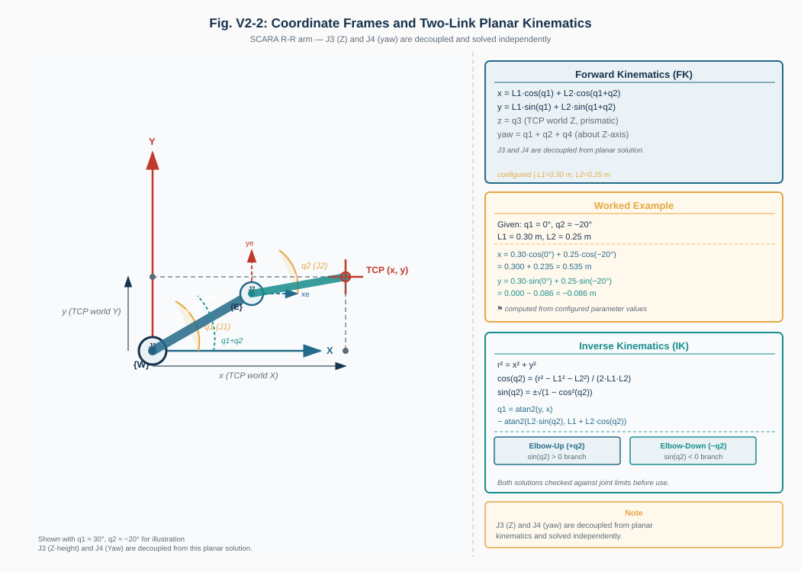
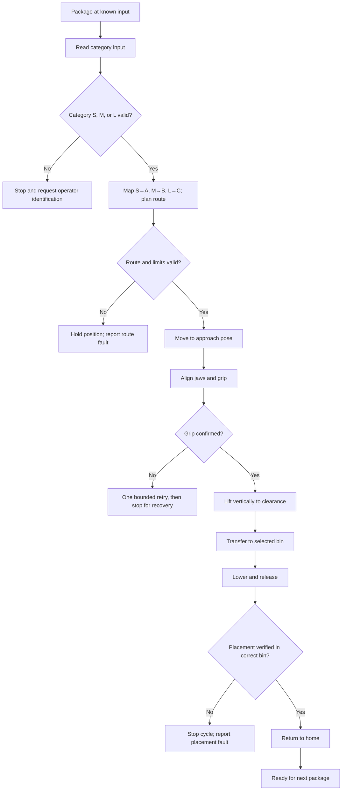

# Automated Warehouse Package Sorting Robot
## Week 2 — Engineering Design Review (Version 2.0)

**Course:** Robotics, BCA UG, Semester VII  
**Project choice:** Option 01 — Automated Warehouse Package Sorting Robot  
**Student:** [Student Name]  
**University registration / roll number:** [Student Roll Number]  
**Submission date:** [Submission Date]  
**Report type:** Individual, cumulative design workbook — engineering milestone  
**Milestone window:** Friday–Sunday, 23–25 October 2026; use faculty-announced cut-off  
**Milestone weight:** 7 marks (of 25 total)  
**Week 2 rubric:** Anatomy and kinematics (3); drives and end effector (2); control logic (2)  
**System summary:** A fixed four-axis SCARA-style cell uses an assumed category input and parallel-jaw gripper to sort one package at a time from a known infeed to Bin A, B, or C.

> Design and simulation evidence only. No physical robot, hardware test, or industrial safety validation is claimed.

## Contents

1. Problem, package inputs, and preliminary requirements  
2. Refined architecture and configuration  
3. Robot anatomy, frames, and kinematics  
4. Drives, gripper, and force screen  
5. Control, failure response, safety, and limitations  
6. References and change log

## 1. Problem, package inputs, and requirements

The cell handles one arriving package at a known input position. A category signal determines the destination: small carton S→Bin A, medium cylinder M→Bin B, and large pouch L→Bin C. The controller plans a pickup, confirmed grip, lift, transfer, release, and return-home sequence. The design goal is a plausible fixed-cell arrangement with measurable package assumptions, adequate reach, a grip method suitable for mixed packages, and safe handling logic. The 12 s median cycle value is a target, not an achieved physical or software result. The brief permits a credible drawing, model, or simulation and does not require a physical build.

**Table 1. Assumed package specifications and destination mapping**

| Category | Example and model shape | Assumed dimensions (L × W × H) | Assumed mass | Destination |
|---|---|---:|---:|---|
| S | Small carton / cuboid | 0.08 × 0.06 × 0.04 m | 0.10 kg | Bin A (B1) |
| M | Medium cylindrical container / cylinder with 0.09 m diameter | 0.12 × 0.09 × 0.06 m envelope | 0.30 kg | Bin B (B2) |
| L | Lightweight pouch / rounded rigid proxy | 0.16 × 0.12 × 0.08 m | 0.60 kg | Bin C (B3) |

All package values are student-defined assumptions already configured in SortLab, not vendor data or measurements. The pouch proxy omits flexing and contents motion. Indoor operation, single-package feed, known pickup center, and non-hazardous items are assumed.

## 2. Refined architecture and configuration

**Figure 1. Refined system architecture.** Solid blocks indicate implemented software/simulation functions; dashed blocks identify conceptual physical hardware. The existing category input is operator-selected, not camera/barcode sensing. A physical version would need actual sensing, drives, feedback, controller, and power hardware.

The refined concept remains the four-axis SCARA-style arrangement (R–R–P–R). J1/J2 position the arm in the horizontal plane, J3 gives vertical approach/lift, and J4 adjusts tool yaw.

**Table 2. Configuration comparison carried forward from Week 1**

| Configuration | Advantages | Trade-offs | Decision |
|---|---|---|---|
| Cartesian gantry | Rectangular workspace, direct XYZ moves, simple position interpretation | Rails span the infeed and bins; larger frame for this tabletop cell | Feasible alternative if station layout becomes rectangular or expands |
| Four-axis SCARA-style | Compact planar footprint, vertical pick axis, wrist yaw, simple two-link model | Annular reach, joint limits/singularities, and link clearance need checking | Preferred for the current fixed, nearby stations |

The SCARA preference is a reasoned concept choice, not a measured cost, throughput, or payload comparison. It accepts an annular workspace and joint-limit checks.

The functional architecture is: simplified category input → controller/state machine → forward/inverse kinematics and fixed-cell route → electric-drive concept → SCARA mechanism → parallel-jaw tool. Feedback should include joint position and confirmed grip state; package placement must be verified. The existing simulation implements category selection, route/controller logic, kinematic arm motion, a virtual gripper, and package physics. Physical power, sensing, motors, and encoders remain conceptual. See Figure 1.

**Table 3. Refined design parameters and status**

| Parameter | Current value | Classification |
|---|---:|---|
| Links | L₁ = 0.30 m, L₂ = 0.25 m | Configured assumed geometry |
| J1 / J2 limits | ±150° / ±160° | Provisional model limits |
| J3 TCP world height | 0.30–0.58 m | Provisional model travel |
| J4 yaw | ±180° | Provisional model limit |
| Home | q = (0, 0, 0.56 m, 0); TCP = (0.55, 0, 0.56 m) | Configured model target |
| Jaw opening | 0.03–0.16 m | Assumed range, no hardware selection |
| Virtual jaw capacity | 25 N per jaw | Model gate, not a rated gripper |
| Median cycle aspiration | ≤12 s | Target only |
| Arm payload margin | Unspecified | Arm rating and tool mass unavailable |

## 3. Robot anatomy, coordinate frames, and kinematics

### Anatomy and independent degrees of freedom

**Figure 2. SCARA-style anatomy and commanded axes.** The anatomy diagram is an existing project illustration.

**Table 4. Joint inventory**

| Joint | Type and axis | Independent motion | Purpose |
|---|---|---|---|
| J1 | Revolute about world +Z at base | q₁, rad | Swings link 1 around the shoulder |
| J2 | Revolute about parallel +Z at elbow | q₂, rad, relative to link 1 | Folds/extends link 2 |
| J3 | Prismatic vertical axis | q₃, m; defined as TCP world-Z | Approaches, lifts, and sets transfer height |
| J4 | Revolute tool yaw about +Z | q₄, rad | Aligns parallel jaws to package sides |

There are four independent commanded axes. This is enough for planar X–Y positioning, vertical Z positioning, and tool yaw around Z. It does not provide general six-axis orientation or arbitrary 3D positioning. The base is fixed to the assumed tabletop; links 1 and 2 have configured centerline lengths of 0.30 m and 0.25 m. The tool centre point (TCP) is the modeled package grasp point; the physical jaw/palm offset has not been manufactured or calibrated.

### Frames and two-link forward-kinematics example

Frame **W** is right-handed, with origin at the J1 shoulder, +X toward the input, +Y toward Bin A, and +Z upward. q₁ is measured from +X to link 1; q₂ is relative at the elbow. q₃ is the TCP world-Z coordinate in metres; q₄ is the final wrist yaw contribution. The planar formulas are:

$$x=L_1\cos q_1+L_2\cos(q_1+q_2), \qquad y=L_1\sin q_1+L_2\sin(q_1+q_2)$$

$$z=q_3, \qquad \psi=q_1+q_2+q_4$$

**Figure 3. Coordinate frames and two-link geometry.** The diagram shows W, link directions, joint angles, and the numerical example below.

**Worked FK example** (simplified planar arm; link thickness, tool offset, and flex are ignored):

1. Assume `L₁ = 0.30 m`, `L₂ = 0.25 m`, `q₁ = 0°`, `q₂ = −20°`, `q₃ = 0.450 m`, and `q₄ = 0°`.
2. The second link absolute angle is `q₁ + q₂ = −20°`.
3. Substitute into X:

   `x = 0.30 cos(0°) + 0.25 cos(−20°)`  
   `x = 0.300000 + 0.234923 = 0.534923 m ≈ 0.535 m`.
4. Substitute into Y:

   `y = 0.30 sin(0°) + 0.25 sin(−20°)`  
   `y = 0.000000 − 0.085505 = −0.085505 m ≈ −0.086 m`.
5. `z = q₃ = 0.450000 m`; `ψ = 0° − 20° + 0° = −20°`.

Thus, the ideal TCP pose is **(0.534923, −0.085505, 0.450000 m, −20°)**. Rounded X/Y values match the existing V2 coordinate-frame illustration. This is analytical, not a measured robot pose.

### Preliminary workspace check

The link-only radial envelope is 0.05–0.55 m. The pickup radius is 0.30 m; each bin radius is `√(0.24² + 0.25²) ≈ 0.347 m`. The elevated transit point `(0.12, ±0.40) m` is approximately 0.418 m from the base. These positions fall inside the ideal radial envelope. The elbow range ±160° raises the theoretical inner radius to about 0.1075 m. Height, J1/J2 limits, tool/package size, and obstacles still apply. The existing workspace diagram marks stations and reach guides but explicitly is not a collision map.

## 4. Drive mechanism, end effector, and force calculation

### Drive choice

Electric drives are proposed: rotary electric servo/gear units for J1, J2, and J4, with a linear electric actuator or screw axis for J3. Electric drives fit a compact cell and permit commanded position feedback without assuming an air supply. Pneumatic motion could be fast and mechanically simple, but it needs compressed air and regulated force/position control. Hydraulic drives are disproportionate for the assumed sub-kilogram packages and introduce fluid-system complexity. No motor, gearbox, brake, voltage, current, torque, or actuator part number is selected. Drive sizing requires arm/tool mass, inertia, duty cycle, and safety factors, none of which is established here.

### Gripper choice

A two-finger parallel-jaw gripper is the preliminary choice because it can contact opposite sides of cartons and a cylinder and can close around the rigid pouch proxy. Replaceable compliant pads and bounded force are desirable to reduce slip and crushing. Suction was rejected because a carton face, curved cylinder, and flexible pouch do not provide equally reliable sealed surfaces. A mechanical adaptive/finger gripper may conform better to a real pouch but adds complexity. The configured jaw opening is 0.03–0.16 m. Material, surface friction, crush limits, and real grasp tolerances must be measured.

### Simplified grip-force screen

Assume a symmetric friction grip, equal normal force `N` at each jaw, two contact faces, vertical acceleration `a_z = 0.30 m/s²`, gravity `g = 9.81 m/s²`, safety factor `S = 2`, and friction coefficient `μ = 0.50`. This is a conservative conceptual calculation; μ is uncertain and the model does not include pad deformation or force control.

1. Required upward holding force with the safety factor is `S m(g + a_z)`.
2. Two friction contacts provide at most `2 μ N` in this simplified model.
3. Set available friction at least equal to required holding force:

   $$2\mu N \ge S m(g+a_z) \quad\Rightarrow\quad N_{required}=\frac{S m(g+a_z)}{2\mu}$$

4. Use the heaviest assumed package, L: `m = 0.60 kg`.
5. Substitute with units:

   `N_required = [2 × 0.60 kg × (9.81 + 0.30) m/s²] / [2 × 0.50]`  
   `N_required = 12.132 N per jaw` (rounded to 12.13 N/jaw).

6. If friction falls to `μ = 0.30`, `N_required = 20.22 N/jaw`. The configured 25 N/jaw is only a virtual capacity assumption, leaving little margin at lower friction. It is not a selected actuator rating or demonstrated contact force. It says nothing about the robot arm's structural payload rating.

## 5. Control, failure response, and safety

### Sorting flow

The intended ordering is detect → approach → grip → lift → transfer → release → verify → return. Existing project logic performs the category as operator-selected simulated input; diagrammed physical sensing remains proposed.

### Failure handling

If the category is unknown, the controller should not guess a bin. If grip confirmation fails, it may re-align and make one controlled retry; a second miss should stop the cycle, keep the package supported, and call for operator recovery. During transfer, loss of grip/attachment should stop further commanded motion and latch a fault. A blocked route must be rejected before movement. A placement that is outside the correct bin or not settled receives no success credit. These are intended design responses; not every physical sensing function exists in the model.

### Safety and practical constraints

The three principal hazards remain pinch/unexpected motion, dropped/crushed packages, and collisions with workcell structures or people. Proposed controls are physical guarding with interlocked access and an independent safe stop; force-limited jaws and a catch region; and clearance planning plus a task-specific risk assessment and validated stopping/collision protection. UI locks and simulated faults do not provide safety protection. No safety certification or fully safe operation is claimed.

**Expected benefit and practical/social impact:** Repetitive fixed transfers could be automated, reducing routine handling and making category-to-bin routing consistent. This may shift operator work toward monitoring and recovery; any benefit depends on safe guarding, maintenance, and the local work context.

**Limitations:** all package and cell values remain assumptions; no real category reader, drive, encoder, gripper, or power supply is selected. No arm payload rating is available, so payload margin remains unknown. The current TCP clearance routes are sampled and are not a swept-link/tool/package collision proof. The flexible pouch, grip friction, and package crush strength are not represented adequately by the simplified calculation.

## 6. References and change log

### References

1. *Robotics — Individual Design Project*, BCA UG Semester VII course brief, Option 01; common requirements; Week 1 and Week 2 deliverables; rubric. Supplied as a DOCX in Downloads; no PDF copy was in the workspace.
2. SortLab project sources: `src/engineering/config.ts`, `kinematics.ts`, `routes.ts`, `trajectory.ts`, and `sortingController.ts`; `docs/ENGINEERING-BASELINE.md` and `docs/PHASE-2-IMPLEMENTATION.md` (accessed 18 October 2026). Configured values are assumptions; implementation is software evidence.
3. Lynch, K. M., and Park, F. C., *Modern Robotics: Mechanics, Planning, and Control*, Cambridge University Press, 2017. DOI: [10.1017/9781316661239](https://doi.org/10.1017/9781316661239). Chapters 4 and 6 for planar forward/inverse kinematics.
4. Existing milestone diagrams: `images-02/V2_Engineering/V2_Robot_Anatomy.svg`, `V2_Coordinate_Frames.svg`, and `images-02/V3_Final/V3_System_Architecture.svg` / `V3_Workspace_Reach.svg`.

### Dated change log

| Date | Version | Change and reason |
|---|---|---|
| 18 October 2026 | V1.0 | Established concept, inputs, configuration comparison, architecture, and initial hazard review. |
| 18 October 2026 | V2.0 | Kept the V1 package and SCARA assumptions; added anatomy and joint definitions, frames and worked FK, drive/gripper trade-offs, transparent grip-force estimate, control flow and failure response. These sections provide the Week 2 mathematics and engineering evidence required by the brief. No faculty feedback record was found, so no feedback is attributed. |
