# Automated Warehouse Package Sorting Robot
## Week 3 — Final Design Review (Version 3.0)

**Course:** Robotics, BCA UG, Semester VII  
**Project choice:** Option 01 — Automated Warehouse Package Sorting Robot  
**Student:** [Student Name]  
**University registration / roll number:** [Student Roll Number]  
**Submission date:** [Submission Date]  
**Report type:** Individual, cumulative design workbook — final design milestone  
**Milestone window:** Friday–Sunday, “30–1 October 2026” as printed in the brief; confirm the ambiguous wording and faculty cut-off  
**Milestone weight:** 8 marks (of 25 total)  
**Week 3 rubric:** Path and trajectory (3); integrated design and safety (2); visual demonstration (1); engineering refinement (2)  
**System summary:** A fixed four-axis SCARA-style cell uses a simplified category input and parallel-jaw gripper to sort assumed package classes S, M, and L into Bin A, B, and C.

> This report combines a proposed physical design with existing software simulation evidence. It does not claim a physical robot was built or tested. The browser screenshot is software evidence, not a robot photograph.

## Contents

1. Final problem definition and requirements  
2. Integrated architecture and configuration  
3. Robot anatomy, reach, and kinematics  
4. Drives, gripper, and holding-force estimate  
5. Waypoints, path planning, and cubic motion  
6. Control and failure handling  
7. Safety, feasibility, and evaluation  
8. Demonstration, conclusion, references, and change log

## 1. Final problem definition and package requirements

### Problem definition

The proposed cell accepts one package at a known input center and sorts it to one of three fixed bins based on a category signal. Small carton S maps to Bin A, medium cylindrical container M to Bin B, and large lightweight pouch L to Bin C. The robot approaches from above/near the package, grips it with parallel jaws, lifts it above the support, transfers through an elevated route, places/releases it at the destination, verifies the bin result, and returns to home. The fixed-cell scope avoids general warehouse navigation. Category recognition is simplified: the current SortLab application takes an operator-selected category. It contains no camera or barcode device. The package dimensions and masses below are measurable design assumptions supplied in configuration, not physical measurements.

**Table 1. Final package specification assumptions**

| ID | Package category / assumed model | Dimensions (L × W × H) | Mass | Destination |
|---|---|---:|---:|---|
| S | Small carton; cuboid | 0.08 × 0.06 × 0.04 m | 0.10 kg | Bin A (B1) |
| M | Medium cylinder; 0.09 m diameter, 0.06 m height, envelope shown | 0.12 × 0.09 × 0.06 m | 0.30 kg | Bin B (B2) |
| L | Large lightweight pouch; rounded rigid proxy only | 0.16 × 0.12 × 0.08 m | 0.60 kg | Bin C (B3) |

**Assumptions and status:** The course brief requires student-defined package data, station geometry, approximate reach, and target motion/cycle assumptions but does not provide exact values. These inputs are inherited from `src/engineering/config.ts`. The cylinder row uses the project's package envelope; its ideal shape is a cylinder with diameter equal to width. The pouch proxy has no deformation or shifting contents. The cell is indoors, tabletop, single-package, and non-hazardous. The assumed median cycle target is ≤12 s. The project simulation later measured a median of 30.350 simulated seconds, so this target was not met in simulation.

## 2. Integrated architecture and final configuration

### Final architecture

**Figure 1. Integrated system architecture.** Existing project diagram; solid elements are implemented software/simulation, dashed elements are proposed physical equipment. Physical sensing, actuation, feedback hardware, power, and safety devices are not installed.

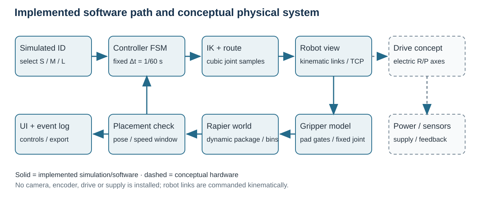

The functional chain is category input → controller/state machine → kinematics and route planner → drive commands → SCARA mechanism → parallel-jaw end effector. Feedback is required for joint positions, grip state, and placement. The existing application supplies an operator-selected simulated category; controls a kinematic robot model through configured routes; checks a virtual grip gate; carries the package with a Rapier fixed-joint model; releases it into a dynamic package simulation; and verifies package pose/settling against the selected bin. These are software and simulation functions. No camera, barcode reader, encoder, motor drive, power unit, physical gripper, or robot arm is installed.

### Configuration comparison and decision

**Table 2. Configuration alternatives and design trade-offs**

| Configuration | Suitability | Advantages | Trade-offs and reason for decision |
|---|---|---|---|
| Cartesian gantry | Viable for fixed rectangular stations | Direct X/Y/Z moves; rectangular work envelope; simple axis-level explanation | Long rails and a larger frame span the infeed and bins; less compact for the assumed tabletop cell |
| Four-axis SCARA-style (R–R–P–R) | Selected for this fixed cell | Compact planar footprint; vertical pickup axis; wrist yaw; simple analytic planar kinematics | Annular/restricted reach, singular configurations, and possible link interference require explicit planning and clearance validation |

SCARA remains the preferred concept because the infeed and three bins are fixed and within a compact region. The design does not claim superior speed, precision, or cost from measured comparison. The project model and reach checks support a preliminary geometric case only; arm payload, structural stiffness, actuator capacity, and physical clearance still need engineering verification.

## 3. Robot anatomy, DOF, workspace, and reach verification

**Figure 2. Robot anatomy.** Existing labeled illustration of base, two planar links, revolute joints, vertical slide, wrist yaw, and TCP.

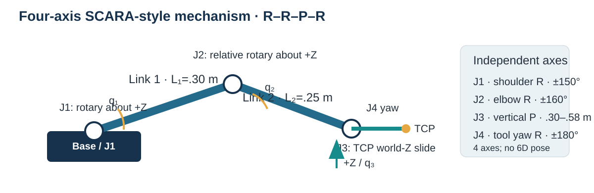

There are four independent axes: J1 revolute shoulder about +Z; J2 revolute elbow about +Z and relative to link 1; J3 prismatic vertical motion expressed as the TCP world-Z coordinate; and J4 revolute tool yaw about +Z. The base is fixed. Links have assumed centerline lengths L₁=0.30 m and L₂=0.25 m. The modeled TCP is the package grasp point; a physical gripper offset and compliance are not calibrated. Four axes provide X/Y position, height, and yaw, not full six-dimensional pose control.

### Workspace and reach/clearance check

**Figure 3. Workcell map with configured station heights.** Existing V3 diagram; the side-view levels are schematic and do not establish swept clearance.

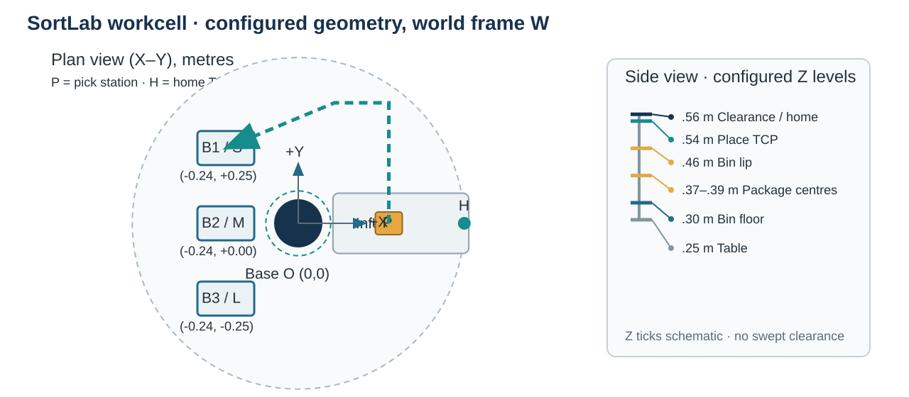

**Figure 4. Workspace and configured station targets.** The diagram is a reach guide and layout view, not a swept collision map.

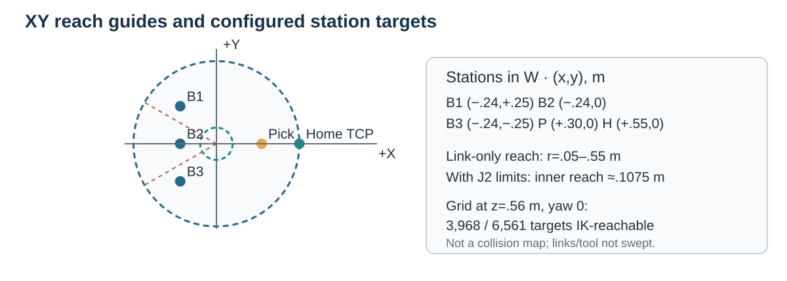

Frame W origin is the shoulder. Assumed station coordinates are pickup P=(+0.30, 0.00) m; Bin A/B1=(−0.24,+0.25) m; Bin B/B2=(−0.24,0.00) m; Bin C/B3=(−0.24,−0.25) m. The configured home TCP is (+0.55,0,0.56) m at q=(0,0,0.56 m,0). The J3 travel is 0.30–0.58 m; transfer height is 0.54 m and clearance/home height is 0.56 m.

1. Ideal link-only planar reach is `|L₁−L₂| ≤ r ≤ L₁+L₂`, giving `0.05 ≤ r ≤ 0.55 m`.
2. The elbow model limits are ±160°. The resulting joint-limited inner radial guide is approximately 0.1075 m; the maximum remains 0.55 m at full extension, a singular boundary.
3. Pickup radius is `√(0.30²+0²)=0.300 m`.
4. Bin A and C radii are `√(0.24²+0.25²)=0.3466 m`; Bin B radius is 0.240 m.
5. Elevated transit coordinates are (+0.12,+0.40,0.56) m for A/B and (+0.12,−0.40,0.56) m for C; their planar radius is `√(0.12²+0.40²)=0.4176 m`.
6. These station points are inside the ideal radial envelope and within J3 height limits. A sampled model grid recorded 3,968 of 6,561 targets IK-reachable at one specified height/yaw; that grid is not a collision-free volume certificate.

Reach verification is therefore preliminary. Link, tool, and package swept volumes; bin-lip clearance; tolerances; emergency stopping distance; and human access must be checked before building. Home is at the maximum planar radius and should be reviewed for singularity margin; an alternate home may be preferable after route and joint-limit analysis.

### Coordinate frames and required kinematics example

Frame W is right-handed: +X points toward the infeed, +Y toward Bin A, +Z upward. q₁ is the angle from +X to link 1, q₂ is the relative elbow angle, q₃ is the world-Z TCP coordinate in m, and q₄ contributes wrist yaw. The simplified planar forward kinematics are:

$$x=L_1\cos q_1+L_2\cos(q_1+q_2), \qquad y=L_1\sin q_1+L_2\sin(q_1+q_2)$$

$$z=q_3, \qquad \psi=q_1+q_2+q_4$$

**Figure 5. Coordinate frames and worked two-link example.** Existing diagram labels the frame and joint angles.

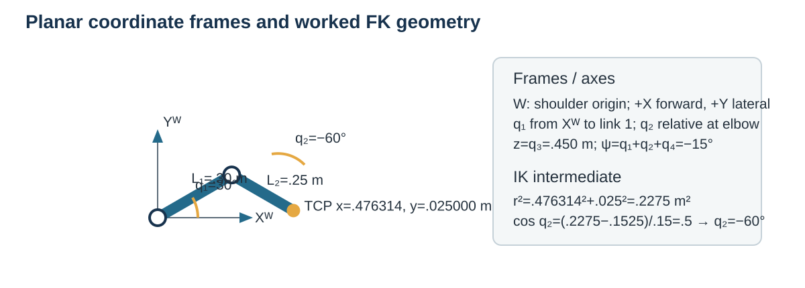

For `L₁=0.30 m`, `L₂=0.25 m`, `q₁=30°`, `q₂=−60°`, `q₃=0.450 m`, and `q₄=15°`:

1. `q₁+q₂=−30°`.
2. `x=0.30 cos 30° + 0.25 cos(−30°) = 0.259808 + 0.216506 = 0.476314 m`.
3. `y=0.30 sin 30° + 0.25 sin(−30°) = 0.150000 − 0.125000 = 0.025000 m`.
4. `z=q₃=0.450000 m`; `ψ=30°−60°+15°=−15°`.

The ideal pose is `(0.476314, 0.025000, 0.450000 m, −15°)`. Link flex, offsets, backlash, and measurement error are excluded. This is analytical evidence, not measured positioning performance.

## 4. Drive and end-effector selection

### Drives

The proposed drive arrangement is electric rotary servo/gear units for J1/J2/J4 and a linear electric actuator or screw axis for J3. Electric motion is suitable for a compact cell with commanded axes and position feedback and avoids assuming compressed-air infrastructure. A pneumatic alternative can be fast, but requires an air supply and measured regulation; hydraulic actuation is unnecessarily complex for the assumed packages. No product, motor torque, gearbox ratio, speed rating, voltage, current, brake, or structural arm rating is selected. Sizing depends on link/tool mass, inertia, acceleration, duty cycle, and safety requirements.

### End effector and grip-force calculation

A parallel-jaw gripper is selected conceptually to grasp the carton and cylinder and close around the assumed pouch envelope. Compliant replaceable pads are proposed, with force limits based on package crush tests. Suction is less suitable for mixed flat, curved, and flexible contact surfaces. The assumed jaw opening is 0.03–0.16 m. The 25 N/jaw virtual cap is a simulation assumption, not a physical device rating.

For a simplified two-sided friction grip, the combined vertical friction capacity is `2 μ N`. Require a safety factor S over weight plus vertical acceleration:

$$2\mu N \ge S m(g+a_z), \qquad N_{required}=\frac{S m(g+a_z)}{2\mu}$$

Using the heaviest assumed package L: `m=0.60 kg`, `S=2`, `g=9.81 m/s²`, assumed `a_z=0.30 m/s²`, and assumed `μ=0.50`:

1. Effective vertical acceleration is `g+a_z = 9.81+0.30 = 10.11 m/s²`.
2. Required factored load is `S m(g+a_z) = 2 × 0.60 kg × 10.11 m/s² = 12.132 N`.
3. Divide by the two friction contacts and μ: `N_required = 12.132 N / (2 × 0.50) = 12.132 N per jaw`.
4. At a lower illustrative friction `μ=0.30`, `N_required = 12.132/(0.60)=20.22 N per jaw`.

This screen assumes equal force, known Coulomb friction, and no object deformation. The configured virtual capacity of 25 N/jaw gives a modeled capacity/required ratio of about 2.06 at μ=0.50, but only 1.24 at μ=0.30. It is not a physical grip test, does not establish pouch handling, and is not the arm payload margin.

## 5. Waypoints, path planning, and cubic trajectory

### Waypoints

Waypoint coordinates are TCP targets in world frame W, with position in metres and yaw in radians/degrees as shown. Pickup height is the support plane plus half package height: S 0.37 m, M 0.38 m, L 0.39 m. Bin target TCP height is the configured 0.54 m, above the modeled 0.46 m lip; the package is released and allowed to settle into the bin. Home is the configured joint target. These are software model coordinates, not surveyed physical coordinates.

**Table 3. Final named waypoints for an S package to Bin A**

| Waypoint | TCP pose / joint target in W | Purpose and orientation |
|---|---|---|
| Home H | q=(0,0,0.56 m,0); FK TCP=(+0.55,0,0.56) m, yaw 0 | Standby above cell; model target |
| Approach Pₐ | (+0.30,0,0.37) m, yaw 0 | Align above S package center; open jaws |
| Pick P | (+0.30,0,0.37) m, yaw 0 | Close jaws at grasp pose after approach |
| Lift / clearance P꜀ | (+0.30,0,0.56) m, yaw 0 | Raise package vertically after grip confirmation |
| Elevated transit T | (+0.12,+0.40,0.56) m, branch-derived yaw | Move around the central base region at clearance height |
| Bin approach Aₐ | (−0.24,+0.25,0.56) m, branch-derived yaw | Hover over Bin A, above lip |
| Place A | (−0.24,+0.25,0.54) m, yaw 0 | Release over Bin A; package settles under gravity |
| Return | Reverse route after placement acceptance, then H | Return to standby only after verification |

For M, pickup z=0.38 m and destination is Bin B at y=0. For L, pickup z=0.39 m and destination is Bin C at y=−0.25 m; its elevated transit uses y=−0.40 m. The Bin B/Bin C approach and place coordinates replace the Bin A y coordinate above.

### Labelled path and clearance considerations

**Figure 6. Configured elevated route and cubic example.** Existing diagram combines route waypoints with the analytical cubic profile. It illustrates TCP targets only; the route is not swept-volume verified.

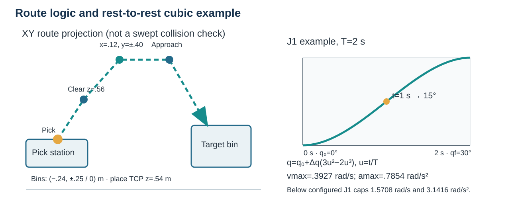

For S→A, the proposed path is **H → Pₐ → P → P꜀ → T → Aₐ → A → release/settle → reverse waypoints → H**. During pick, the tool yaw is 0 to align the jaws with the package sides. The transit/approach yaw is selected from the continuous inverse-kinematic branch; bin target yaw returns to 0. The path rises vertically before lateral movement and remains above the bin lip while approaching. Route logic tries both elbow branches, preserves IK continuity, and samples the TCP path and joint constraints. It does not prove that links, palm, jaws, or carried package clear the conveyor, bins, base, or a person. Tool orientation changes and package rotation must be checked against actual bin opening and package geometry.

**Figure 7. Motion paths and named waypoints.** Existing top-view routes for B1/B2/B3; the drawing notes that vertical clearance moves are not visible in plan view.

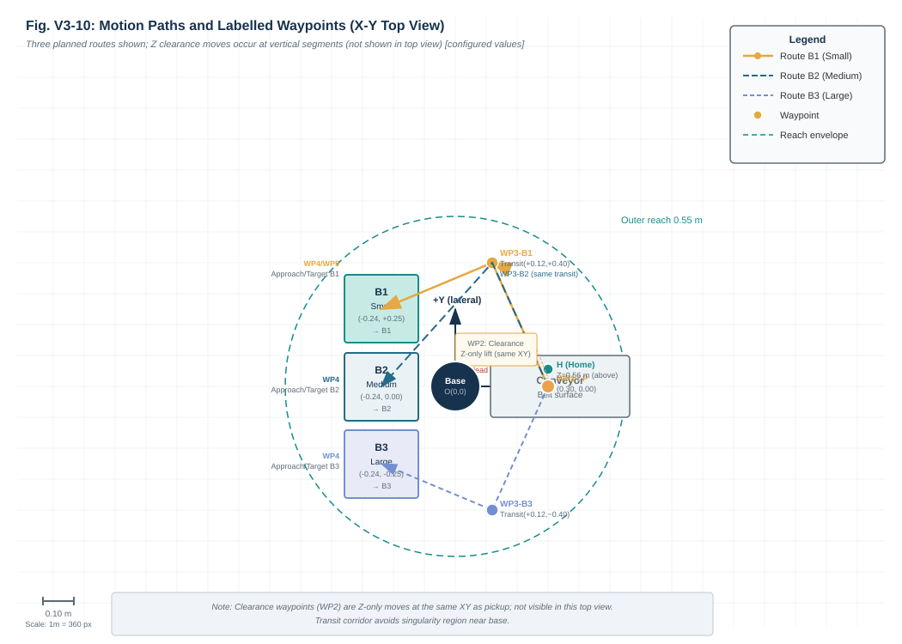

### Joint-space versus Cartesian-space motion

Joint-space interpolation specifies each axis trajectory directly; it is convenient for a home-to-home move and for enforcing each joint's speed/acceleration bounds, but the TCP can follow a curved path that may approach obstacles. Cartesian-space waypoints specify task locations and lift/transfer geometry; inverse kinematics maps them to joints, but branch changes, singularities, and sampled-path collision issues remain. The proposed route uses Cartesian waypoint intent with continuous IK branch selection and joint-limit checks. A physical controller would need calibrated frames, time synchronization, verified interpolation, and continuous/swept collision checking.

### Worked cubic joint trajectory

Use a rest-to-rest cubic for J1 from `q₀=0°` to `q_f=30°` over `T=2.0 s`. Assume zero start and finish angular velocity; this example is independent of the package route measurement. Let `u=t/T`. For zero endpoint velocity, cubic time scaling is:

$$q(t)=q_0+(q_f-q_0)(3u^2-2u^3), \qquad u=\frac{t}{T}$$

Boundary conditions are `q(0)=0°`, `q(T)=30°`, `q̇(0)=0°/s`, and `q̇(T)=0°/s`.

1. At `t=1.0 s`, `u=1.0/2.0=0.5`.
2. Evaluate the cubic blend: `3(0.5²)−2(0.5³)=0.75−0.25=0.50`.
3. `q(1.0 s)=0°+(30°)(0.50)=15°` (or 0.2618 rad).
4. For this profile, `|q̇|max=1.5|Δq|/T = 1.5×0.5236/2.0 = 0.3927 rad/s`.
5. `|q̈|max=6|Δq|/T² = 6×0.5236/(2.0²) = 0.7854 rad/s²`.
6. These are below configured J1 limits of 1.5708 rad/s and 3.1416 rad/s². The example is analytically feasible under those model limits; it is not a measured actuator trajectory or proof of clearance.

## 6. Control flow and failure handling

**Figure 8. Existing controller-state diagram.** Software diagram showing normal sequencing and fault/abort handling; it does not represent a safety-rated controller.

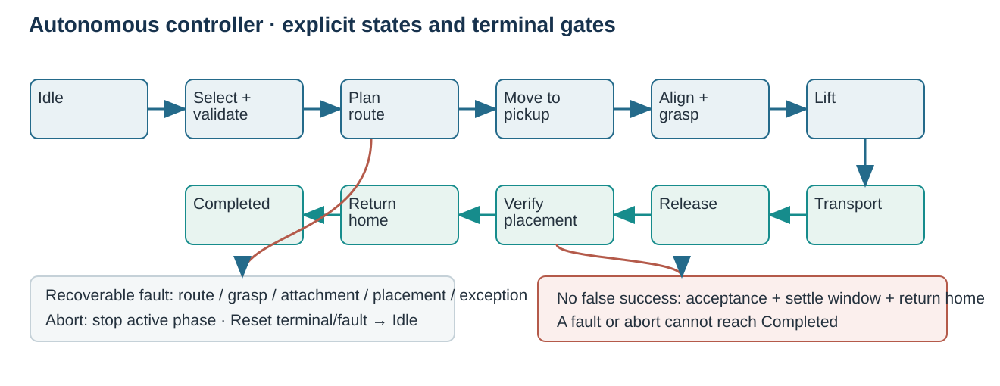

**Figure 9. Package handling and grasp/release verification sequence.** Existing simulated-grasp diagram; it does not represent a physical force sensor or industrial gripper.

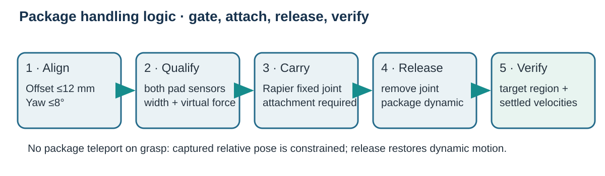

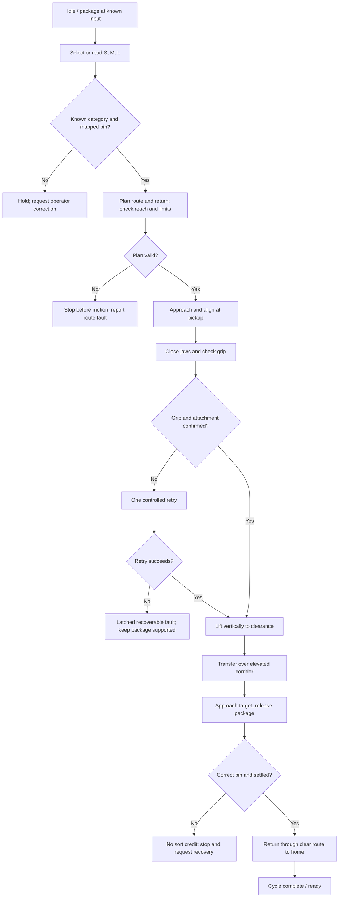

The intended failure case is a lost grasp/attachment during transfer: stop commanded movement, prevent further travel, latch a fault, and require operator recovery. Unknown category, unreachable waypoint, failed bounded retry, release failure, wrong-bin placement, or placement timeout similarly prevents success credit. The current simulation includes controller states and named fault behavior; the category is selected by the operator, and the simulated attachment/placement checks do not establish real sensor performance.

## 7. Safety, feasibility, and evaluation

**Table 4. Hazards, controls, and remaining design limits**

| Hazard | Proposed control before any physical operation | Remaining risk / evidence boundary |
|---|---|---|
| Pinch at arm joints or jaws; unexpected start | Fixed enclosure, interlocked access, controlled restart, independent safety-rated stop, safe maintenance mode | No physical safeguard is built; software/UI stop is not safety rated |
| Package slip, drop, or crush | Measure surface friction and crush force; validate grip force; force-limited pads; guarded catch area | Simplified friction model; pouch deformation and real force are unknown |
| Collision with bin, infeed, or person | Layout risk assessment; validated swept-volume/stop-distance analysis; guarding and restricted access | Current reach/path check samples TCP only and does not verify full arm/tool/package volumes |

**Feasibility:** The assumed station radii fit inside the link-only and configured joint-limited workspace, with the listed vertical targets within J3's model range. This supports a preliminary geometric feasibility case for a fixed cell. A complete payload/reach clearance claim is not possible: structural rating, component masses, full tool geometry, tolerances, cycle duty, and collision clearances are missing. The specified 12 s median aspiration is ambitious relative to the existing simulated median.

**Evaluation evidence already present:** The project audit reports 100/100 correct terminal placements in a nominal simulation campaign (S=34, M=33, L=33), and a median simulated cycle time of 30.350 s (mean 30.680 s; range 29.917–31.783 s). The 12 s median target was missed. A separate injected-fault campaign reports 36/36 expected controller outcomes across 12 fault classes, with no false-positive placements and clean resets/reruns. The project also reports 5,000 FK/IK round trips and a sampled reach grid. These are software/simulation outputs from project records, not physical measurements, robot accuracy, or proof of industrial reliability. Some fault cases use deterministic hooks or validation setup rather than naturally occurring physics failures.

**Expected benefit and practical/social impact:** A fixed sorter could reduce repetitive manual transfers and improve consistency of routing. It may shift staff effort toward monitoring and fault recovery, and it introduces guarding, maintenance, training, and job-change needs. The practical impact depends on cell throughput and safe integration.

**Engineering refinement and future improvement:** The existing project audit corrected the virtual grip-force screen to include the assumed vertical acceleration term and added a regression check; the final equation above reflects that refinement. No faculty feedback record was available, so this is recorded as a source/code review improvement rather than attributed to faculty. Next, replace operator-selected category with a validated barcode/label input, log confidence, and hold unknown labels for manual resolution. Before physical build, prioritize swept-volume clearance checks and measured actuator/grip sizing, then investigate the missed cycle-time target without reducing validated clearance.

## 8. Demonstration and conclusion

### Demonstration evidence

The existing project contains nine annotated engineering diagrams and a Playwright browser workcell capture. The capture is actual software-rendered browser evidence from the project and is not an image of a physical robot. The linked route, anatomy, workspace, architecture, and controller figures are proposed-design illustrations. No paper model or physical robot demonstration was found in the workspace.

**Figure 10. Existing browser workcell capture.** Playwright smoke-test screenshot from the SortLab application; software/simulation evidence only, not a physical robot photograph or hardware test.

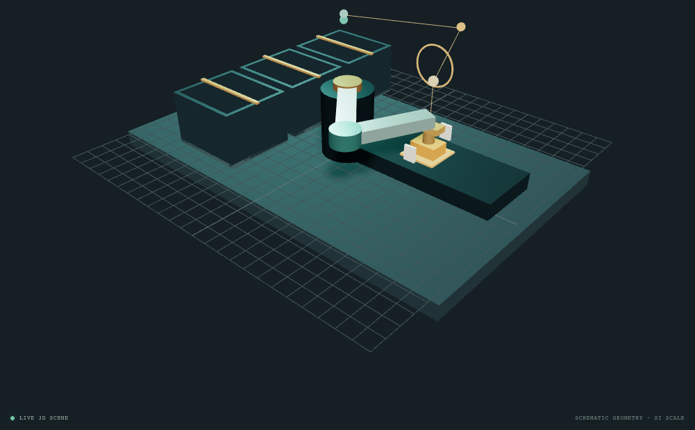

**Figure 11. Simulated campaign cycle-time summary.** Existing V3 chart uses the checked-in 100-row campaign; durations are simulated seconds.

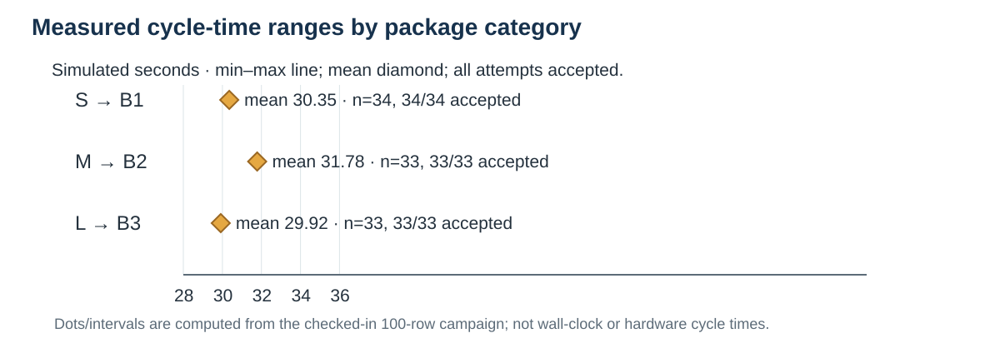

A presentation demonstration can show a labeled frame sequence: (1) package at P with category S selected; (2) arm approaches and closes jaws; (3) confirmed virtual grasp and vertical lift; (4) elevated transit to Bin A; (5) release and simulated settling check; (6) return to home. The existing browser screenshot supports that the software workcell was opened and rendered; it does not by itself establish that the pictured frame sequence was physically performed. The simulation campaign evidence is separately summarized above.

### Conclusion

The selected concept is a fixed four-axis SCARA-style sorter with a simplified category input, electric-drive concept, parallel-jaw end effector, three assumed package categories, and fixed bin locations. Its link geometry can reach the configured station centers in a planar model, and analytical kinematics, a simplified grip-force screen, fixed-cell route logic, and a cubic trajectory example support the design explanation. Existing software records show sorting behavior in simulation and expose remaining cycle-time and fault-handling considerations. Before construction, a competent design review would need to verify actual package properties; arm/tool payload and actuator ratings; joint and tool swept clearances; grasp and crush forces; sensor/controller behavior; repeatability; cycle time; stopping distance; guarding/interlocks; and independent safety functions. No safety, reliability, or physical performance is proven by this report.

## References

1. *Robotics — Individual Design Project*, BCA UG Semester VII course brief, Option 01, common engineering requirements, weekly milestones, assessment rubric, and suggested report structure. The supplied original was available as `Robotics Course Project Brief.docx` in Downloads; no PDF copy was found in the workspace. Course wording lists the V3 date as “30–1 Oct 2026”; it is ambiguous and should be confirmed with faculty.
2. SortLab project sources, accessed 18 October 2026: `src/engineering/config.ts`, `kinematics.ts`, `routes.ts`, `trajectory.ts`, `sortingController.ts`, `packagePhysics.ts`; `docs/ENGINEERING-BASELINE.md`, `docs/ARCHITECTURE.md`, `docs/PHASE-2-IMPLEMENTATION.md`, `docs/PHASE-4-IMPLEMENTATION.md`, `docs/PHASE-5-IMPLEMENTATION.md`; and `deliverables-2/report-qa.md` with bundled campaign records. Source values and validation outputs are classified as configured assumptions or software/simulation evidence as described.
3. Lynch, K. M., and Park, F. C., *Modern Robotics: Mechanics, Planning, and Control*. Cambridge University Press, 2017. DOI: [10.1017/9781316661239](https://doi.org/10.1017/9781316661239). Chapters 4, 6, and 9: forward/inverse kinematics and trajectory generation.
4. Northwestern University, Modern Robotics, “9.1 and 9.2: Point-to-Point Trajectories (Part 2 of 2).” [Lesson page](https://modernrobotics.northwestern.edu/nu-gm-book-resource/9-1-and-9-2-point-to-point-trajectories-part-2-of-2/). Access date: 18 October 2026.
5. Dimforge, Rapier JavaScript User Guide, “Rigid-body type.” [Documentation](https://rapier.rs/docs/user_guides/javascript/rigid_body_type/). Kinematic-body contact-force limitation informs the model-boundary description. Access date: 18 October 2026.
6. U.S. Occupational Safety and Health Administration, “Industrial Robot Systems and Industrial Robot System Safety,” OSHA Technical Manual, Section IV, Chapter 4. [OSHA page](https://www.osha.gov/otm/section-4-safety-hazards/chapter-4). Consulted for hazard and safeguard context. Access date: 18 October 2026.

## Dated change log

| Date | Version | Change and reason |
|---|---|---|
| 18 October 2026 | V1.0 | Established Option 01 problem, assumed package data and mapping, preliminary SCARA concept, operating sequence, architecture, workspace reasoning, three hazards, benefit, and limits. |
| 18 October 2026 | V2.0 | Retained V1 inputs/configuration; added joint anatomy and DOF, coordinate frame and FK calculation, drive and gripper rationale, holding-force estimate, control flow and failure response. |
| 18 October 2026 | V3.0 | Integrated home/pick/lift/transit/approach/place/return waypoints, labeled elevated path, joint-versus-Cartesian discussion, cubic example, final safety/feasibility/evaluation, and demonstration evidence. Added actual simulated campaign findings from project records, identified the missed cycle-time target, recorded the audited grip-force equation refinement, and distinguished software evidence from physical validation. No faculty feedback record was available; none is attributed. |
